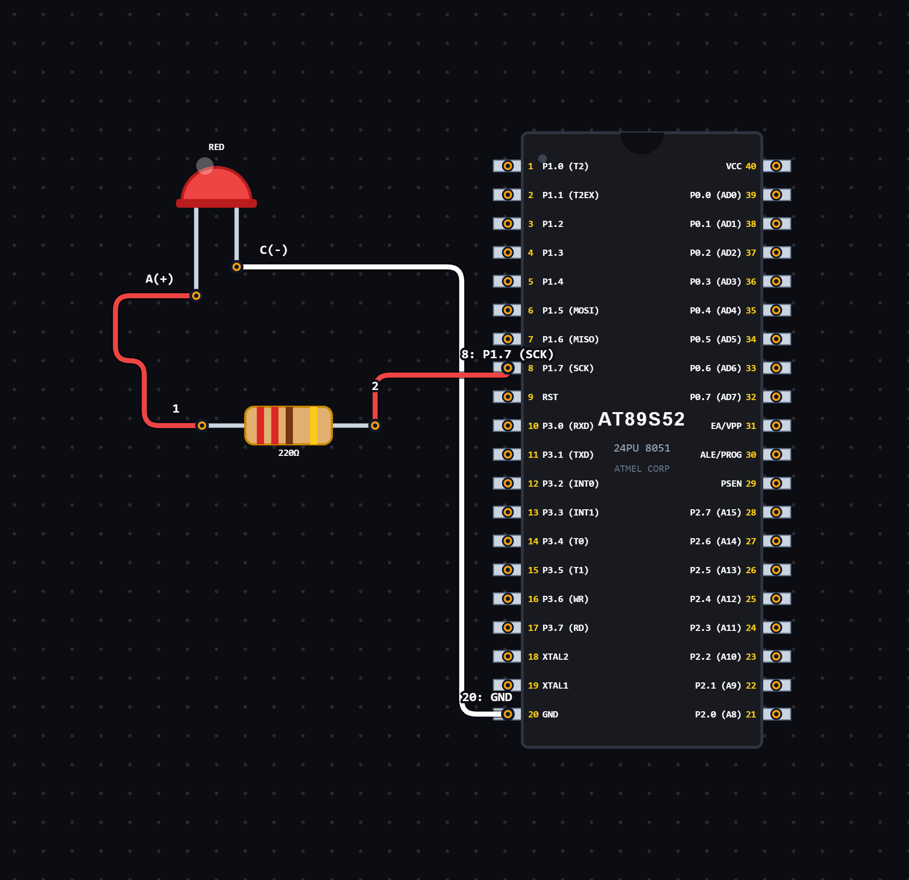

# EXPERIMENT DETAILS

**EXP:** CONTINUOUS ASSESSMENT 2

**DATE:** 24/07/2026

**NAME OF EXP:** Bare-Metal LED Blinking using 8051

**HARDWARE SETUP / PLATFORM:** 8051 Microcontroller + VS Code

---

## TASK 2B : Bare-Metal LED Blink

### 1. Circuit Diagram

The experiment demonstrates LED blinking using an 8051 microcontroller with active-LOW logic.

- **Microcontroller:** 8051
- **GPIO Port:** Port 1
- **GPIO Pin:** P1.7
- **Peripheral:** LED with current-limiting resistor
- **Logic:** Active-LOW (Pull-up configuration)
- **Power Supply:** 5V DC

**Circuit Diagram:**

### 2. Core Logic / Pseudocode / Code Base

**Working Principle:**

The LED is connected to pin P1.7 of the 8051 microcontroller. The program continuously switches the pin between LOW and HIGH states to produce a blinking effect.

Since the LED uses active-LOW logic, setting P1.7 to LOW turns the LED ON, while setting it HIGH turns the LED OFF.

The `delay_1Hz()` function is used to introduce a time delay between the LED transitions.

**Pseudocode:**

1. Include the 8051 register definition header file.
2. Include the delay header file.
3. Define P1.7 as the LED control pin.
4. Set the LED pin LOW to turn it ON.
5. Call the delay function.
6. Set the LED pin HIGH to turn it OFF.
7. Call the delay function again.
8. Repeat continuously.

**Code Base:**

The program is written in Embedded C for the 8051 microcontroller.

- `reg51.h` provides the 8051 register definitions.
- `delay.h` contains the delay function declaration.
- `sbit led = P1^7` assigns the LED to pin P1.7.
- `led = 0` turns the LED ON (active-LOW).
- `led = 1` turns the LED OFF.
- `delay_1Hz()` generates the required time delay.

### 3. Inference

The LED connected to P1.7 blinks continuously as the microcontroller alternates between LOW and HIGH output states.

The experiment demonstrates GPIO output control, active-LOW LED operation, software delay generation and basic Embedded C programming using the 8051 microcontroller.