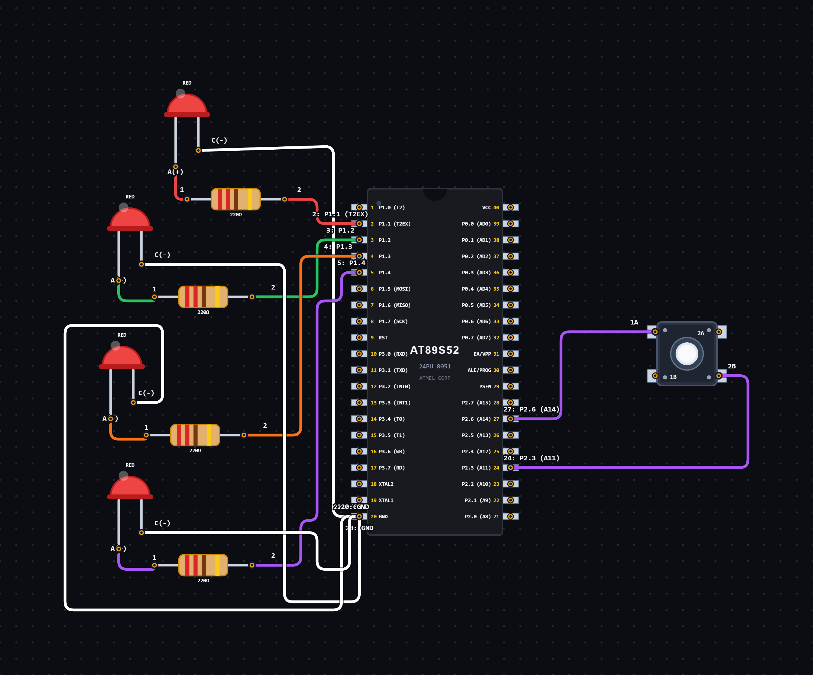

# EXPERIMENT DETAILS

**EXP:** CONTINUOUS ASSESSMENT 2

**DATE:** 31/07/2026

**NAME OF EXP:** Push Button Controlled LED Modes

**HARDWARE SETUP / PLATFORM:** 8051 Microcontroller + VS Code

---

## TASK 3A : Push Button Controlled LED Modes

### 1. Circuit Diagram

The experiment demonstrates push-button-controlled operation of multiple LED modes using an 8051 microcontroller.

- **Microcontroller:** 8051
- **GPIO Port:** As defined in `pins.h`
- **Peripherals:** LEDs and Push Button
- **Control:** Push-button input
- **Programming Language:** Embedded C

**Circuit Diagram:**

### 2. Core Logic / Pseudocode / Code Base

**Working Principle:**

The program starts by initializing all four LEDs and the serial output to LOW.

Initially, the program waits for a button press using the `chkbutton()` function. Once the button is pressed, the program enters four different operating modes.

Each mode is executed using separate functions (`mode1()`, `mode2()`, `mode3()` and `mode4()`).

After executing mode 4, the program returns to mode 1 and continues cycling through the modes.

A software delay function is also implemented using nested loops.

**Pseudocode:**

1. Include the mode and pin definition header files.
2. Initialize the mode variable to 0.
3. Set all four LEDs to LOW.
4. Set the serial output to LOW.
5. Enter an infinite loop.
6. Check the current mode using a switch statement.
7. In mode 0, wait for a button press using `chkbutton()`.
8. Once the button is pressed, move to mode 1.
9. Execute `mode1()` and move to mode 2.
10. Execute `mode2()` and move to mode 3.
11. Execute `mode3()` and move to mode 4.
12. Execute `mode4()` and return to mode 1.
13. Repeat the process continuously.

**Code Base:**

The program is written in Embedded C for the 8051 microcontroller.

- `modes.h` contains the mode-related function declarations.
- `pins.h` contains the pin definitions used in the program.
- `chkbutton()` checks whether the push button is pressed.
- `mode1()`, `mode2()`, `mode3()` and `mode4()` execute the four operating modes.
- `delay_loop(int a, int b)` generates a software delay using nested loops.
- `delay_1Hz()` calls `delay_loop(35,350)` to generate the delay.
- The `switch` statement controls the sequence of mode execution.

### 3. Inference

The experiment demonstrates push-button-based mode selection and sequential execution of four different operating modes using the 8051 microcontroller.

It also demonstrates GPIO initialization, function-based programming, switch-case control structures and software delay generation using Embedded C.