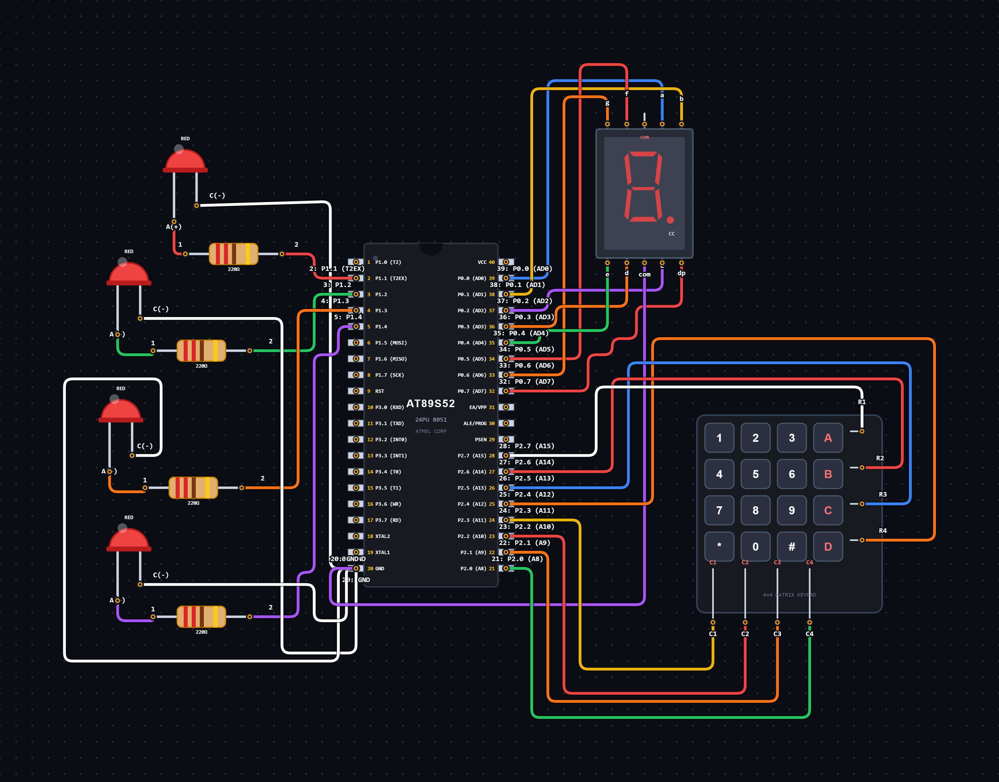

# EXPERIMENT DETAILS

**EXP:** CONTINUOUS ASSESSMENT 3

**DATE:** 07/08/2026

**NAME OF EXP:** Keypad Controlled LED Patterns and Seven Segment Display

**HARDWARE SETUP / PLATFORM:** 8051 Microcontroller + VS Code

---

## TASK 4A : Keypad Controlled LED Patterns and Seven Segment Display

### 1. Circuit Diagram

The experiment demonstrates keypad-based control of four LEDs and a seven-segment display using the 8051 microcontroller.

- **Microcontroller:** AT89S52 (8051)
- **Input Device:** 4×4 Matrix Keypad
- **Output Devices:** Four LEDs and Seven Segment Display
- **Display Type:** Common Cathode
- **LED Control:** Individual LED and multiple LED patterns
- **Power Supply:** 5V DC

**Circuit Diagram:**

### 2. Core Logic / Pseudocode / Code Base

**Working Principle:**

A 4×4 matrix keypad is used to provide input to the 8051 microcontroller. The microcontroller scans the keypad rows and columns to identify the pressed key.

Based on the pressed key, the corresponding LED operation is performed. The seven-segment display is also updated to display numeric values from 0 to 9.

The experiment supports individual LED control and four different LED patterns.

**Key Functions:**

| Key | Operation |
|---|---|
| 1 | LED 1 ON |
| 2 | LED 2 ON |
| 3 | LED 3 ON |
| 4 | LED 4 ON |
| 5 | Running LED Pattern |
| 6 | Alternate LED Pattern |
| 7 | Binary Counter (0–15) |
| 8 | All LEDs Blink |

**Pseudocode:**

1. Include the required header files for pins, functions and delays.
2. Initialize the keypad scanning and display functions.
3. Enter an infinite loop.
4. Scan the keypad to identify the pressed key.
5. Display the pressed numeric key on the seven-segment display if its value is between 0 and 9.
6. Control the LEDs based on the pressed key.
7. If key 1–4 is pressed, turn ON the corresponding LED.
8. If key 5 is pressed, execute the running LED pattern.
9. If key 6 is pressed, execute the alternate LED pattern.
10. If key 7 is pressed, execute the binary counter from 0 to 15.
11. If key 8 is pressed, blink all four LEDs together.
12. Continue scanning for new key presses.

**Code Base:**

The program is written in Embedded C using the 8051 microcontroller.

- `reg51.h` provides the 8051 register definitions.
- `pins.h` contains the pin definitions for the keypad, LEDs and seven-segment display.
- `functions.h` contains the function declarations used in the program.
- `delay.h` contains the software delay function declarations.
- `keypad_scan()` scans the keypad rows and columns to identify the pressed key.
- `seg_code[]` contains the hexadecimal values required to display digits on a common-cathode seven-segment display.
- `display_digit()` updates the seven-segment display for numeric values from 0 to 9.
- `led_control()` selects the LED operation based on the pressed key.
- `running_led()` switches ON LEDs sequentially from LED 1 to LED 4.
- `alternate_led()` alternates between LED 1 and LED 3, and LED 2 and LED 4.
- `binary_counter()` displays binary values from 0 to 15 using four LEDs.
- `blink_all()` switches all four LEDs ON and OFF together.
- `pattern_delay()` introduces a delay while continuously checking for a new key press.
- `delay_loop()` generates software delays using nested loops.

### 3. Inference

The experiment successfully demonstrates keypad-based input processing and control of multiple output devices using the 8051 microcontroller.

It demonstrates matrix keypad scanning, seven-segment display interfacing, individual LED control, running LED patterns, alternate LED patterns, binary counting and software delay generation.

The experiment provides an understanding of interfacing multiple input and output peripherals with a microcontroller using Embedded C programming.