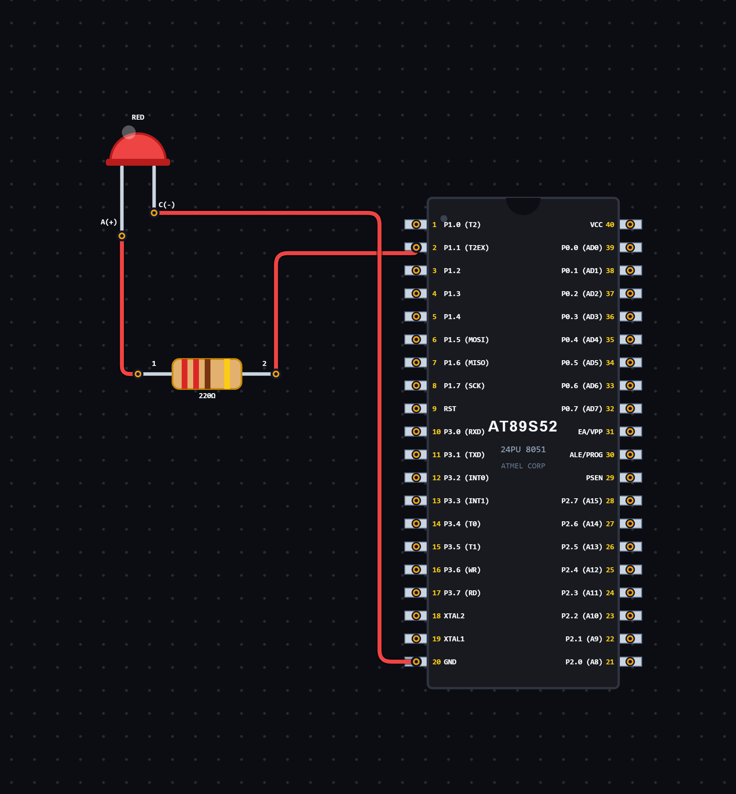

# EXPERIMENT DETAILS

**EXP:** CONTINUOUS ASSESSMENT 5

**DATE:** 14/08/2026

**NAME OF EXP:** LED Blinking Using Timer 0

**HARDWARE SETUP / PLATFORM:** 8051 Microcontroller + VS Code

---

## TASK 5A : LED Blinking Using Timer 0

### 1. Circuit Diagram

The experiment demonstrates LED blinking using Timer 0 of the 8051 microcontroller.

- **Microcontroller:** 8051
- **Timer:** Timer 0
- **Timer Mode:** Mode 1 (16-bit Timer Mode)
- **Peripheral:** LED with current-limiting resistor
- **GPIO Pin:** As defined in `pins.h`
- **Power Supply:** 5V DC

**Circuit Diagram:**

### 2. Core Logic / Pseudocode / Code Base

**Working Principle:**

Timer 0 of the 8051 microcontroller is configured in Mode 1, which is a 16-bit timer mode.

The timer is initialized using the TMOD register, and the TH0 and TL0 registers are loaded with the initial values `0xFA` and `0x9A`.

The timer starts running, and whenever it overflows, the TF0 flag becomes HIGH. The program checks this flag, clears it and reloads the timer registers.

A counter is incremented for every timer overflow. When the counter reaches 533, the LED changes its state and the counter is reset to zero.

This process repeats continuously, producing an LED blinking effect.

**Pseudocode:**

1. Include the required header files.
2. Declare a counter and initialize it to zero.
3. Configure Timer 0 using the TMOD register.
4. Set Timer 0 to Mode 1 (16-bit timer mode).
5. Load TH0 with `0xFA` and TL0 with `0x9A`.
6. Start Timer 0 by setting TR0 to HIGH.
7. Continuously check the TF0 overflow flag.
8. When TF0 becomes HIGH:
   - Clear the TF0 flag.
   - Increment the counter.
   - Reload TH0 and TL0 with their initial values.
9. Check whether the counter has reached 533.
10. If the counter reaches 533:
    - Toggle the LED.
    - Reset the counter to zero.
11. Repeat continuously.

**Code Base:**

The program is written in Embedded C for the 8051 microcontroller.

- `reg51.h` provides the 8051 register definitions.
- `pins.h` contains the LED pin definition.
- `functions.h` contains the function declaration for Timer 0 initialization.
- `TMOD = 0x01` configures Timer 0 in Mode 1 (16-bit timer mode).
- `TH0 = 0xFA` loads the higher byte of the timer.
- `TL0 = 0x9A` loads the lower byte of the timer.
- `TR0 = 1` starts Timer 0.
- `TF0` is the timer overflow flag.
- `count` keeps track of the number of timer overflows.
- `led = ~led` toggles the LED state when the counter reaches 533.
- The timer registers are reloaded after every overflow.

### 3. Inference

The experiment demonstrates the use of Timer 0 in 16-bit timer mode for generating delays and controlling LED blinking.

It provides an understanding of timer configuration, timer overflow detection, register initialization, flag handling and GPIO output control using Embedded C programming on the 8051 microcontroller.