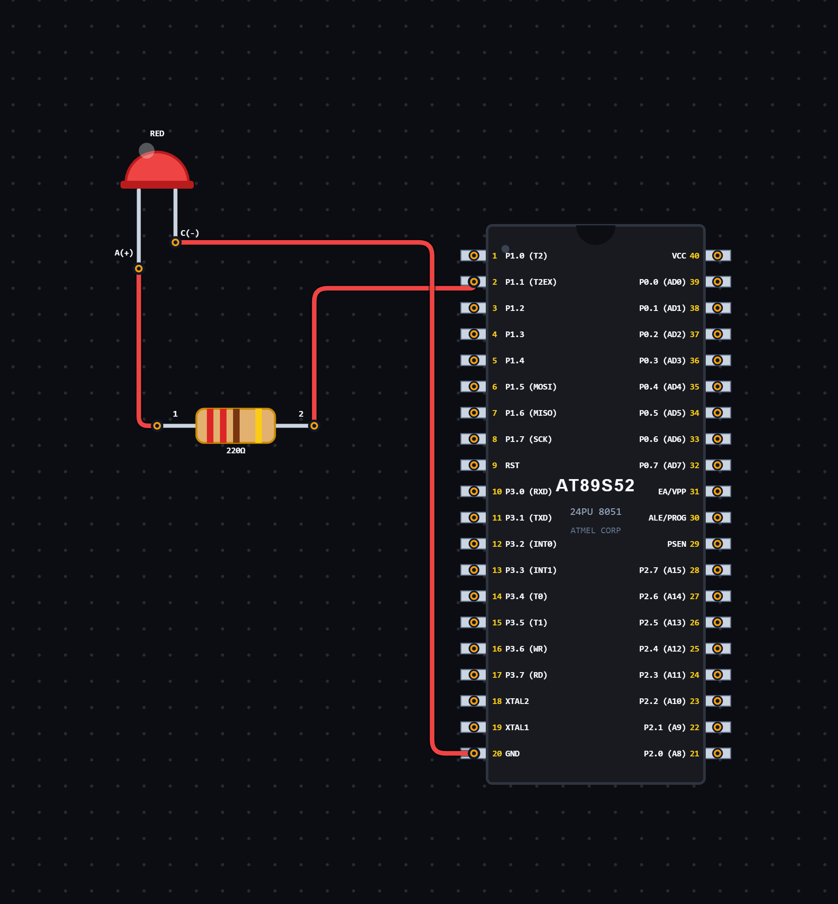

# EXPERIMENT DETAILS

**EXP:** CONTINUOUS ASSESSMENT 5

**DATE:** 14/08/2026

**NAME OF EXP:** LED Brightness Control Using PWM

**HARDWARE SETUP / PLATFORM:** 8052 Microcontroller + VS Code

---

## TASK 5B.1 : LED Fading Using PWM

### 1. Circuit Diagram

The experiment demonstrates LED brightness control using Pulse Width Modulation (PWM) generated through Timer 0 of the 8052 microcontroller.

- **Microcontroller:** 8052
- **GPIO Port:** Port 1
- **GPIO Pin:** P1.0
- **Timer:** Timer 0
- **Timer Mode:** Mode 1 (16-bit Timer Mode)
- **Peripheral:** LED with current-limiting resistor
- **Power Supply:** 5V DC

**Circuit Diagram:**

### 2. Core Logic / Pseudocode / Code Base

**Working Principle:**

The experiment uses Timer 0 to generate software-based Pulse Width Modulation (PWM) for controlling LED brightness.

Timer 0 is configured in Mode 1 (16-bit timer mode) and loaded with the initial values `TH0 = 0xFE` and `TL0 = 0xA3`.

Whenever the timer overflows, the PWM tick counter is incremented. The PWM period is divided into 20 ticks, and the LED is switched ON or OFF depending on the current duty cycle.

The duty cycle gradually increases from 0 to 20, making the LED brighter. Once it reaches the maximum value, the duty cycle decreases back to zero, making the LED dimmer.

This process repeats continuously to create a fading effect.

**Pseudocode:**

1. Include the 8052 register definition header file.
2. Define P1.0 as the LED control pin.
3. Initialize the PWM tick counter and duty cycle to zero.
4. Set the brightening flag to HIGH.
5. Configure Timer 0 in Mode 1 using the TMOD register.
6. Load TH0 with `0xFE` and TL0 with `0xA3`.
7. Start Timer 0.
8. Continuously check the TF0 overflow flag.
9. When the timer overflows:
   - Clear the TF0 flag.
   - Stop Timer 0 temporarily.
   - Reload the timer registers.
   - Restart Timer 0.
10. Increment the PWM tick counter.
11. Reset the PWM tick counter when it reaches 20.
12. Compare the PWM tick counter with the duty cycle:
   - If the PWM tick is less than the duty cycle, turn the LED ON.
   - Otherwise, turn the LED OFF.
13. Increment the fade delay counter.
14. When the fade delay reaches 200:
   - Reset the fade delay counter.
   - Increase the duty cycle if the LED is brightening.
   - Decrease the duty cycle if the LED is dimming.
15. Repeat continuously to produce the LED fading effect.

**Code Base:**

The program is written in Embedded C for the 8052 microcontroller.

- `reg52.h` provides the 8052 register definitions.
- `sbit LED = P1^0` assigns the LED to pin P1.0.
- `TMOD = 0x01` configures Timer 0 in Mode 1 (16-bit timer mode).
- `TH0 = 0xFE` and `TL0 = 0xA3` load the initial timer values.
- `TR0 = 1` starts Timer 0.
- `TF0` indicates timer overflow.
- `pwm_tick` keeps track of the current position within the PWM cycle.
- `duty_cycle` determines the ON duration of the LED within each PWM cycle.
- `brightening` determines whether the duty cycle is increasing or decreasing.
- `fade_delay` controls the rate at which the duty cycle changes.
- `LED = 1` turns the LED ON.
- `LED = 0` turns the LED OFF.

### 3. Inference

The experiment demonstrates LED brightness control using software-generated PWM and Timer 0 of the 8052 microcontroller.

The LED gradually increases and decreases in brightness as the duty cycle changes between 0 and 20.

The experiment provides an understanding of timer configuration, PWM generation, duty cycle control and brightness variation using Embedded C programming.