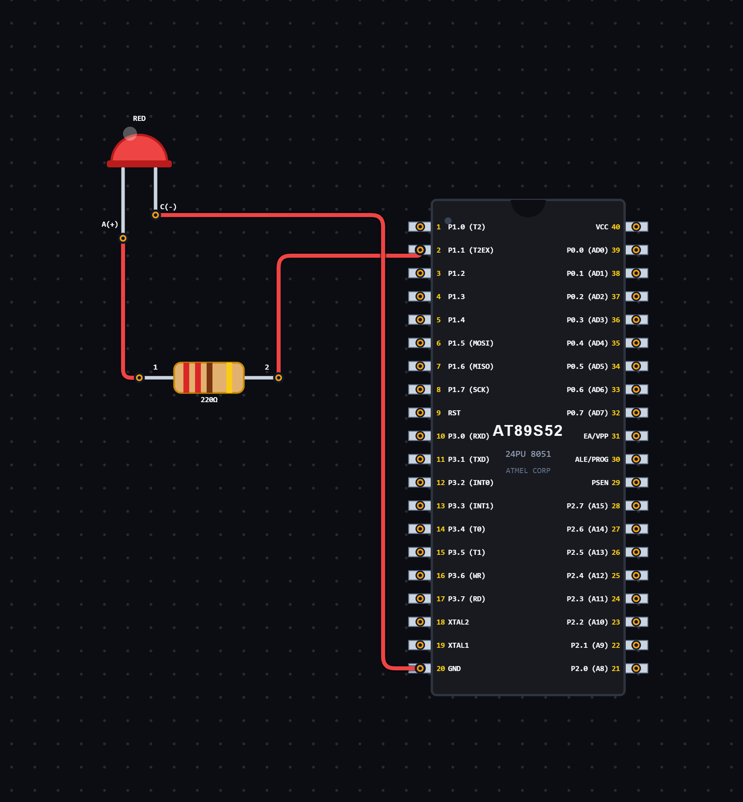

# EXPERIMENT DETAILS

**EXP:** CONTINUOUS ASSESSMENT 5

**DATE:** 14/08/2026

**NAME OF EXP:** Square Wave Generation Using Timer 0

**HARDWARE SETUP / PLATFORM:** 8052 Microcontroller + VS Code

---

## TASK 5B.2 : Square Wave Generation Using Timer 0

### 1. Circuit Diagram

The experiment demonstrates square wave generation using Timer 0 of the 8052 microcontroller.

- **Microcontroller:** 8052
- **GPIO Port:** Port 1
- **GPIO Pin:** P1.1
- **Timer:** Timer 0
- **Timer Mode:** Mode 1 (16-bit Timer Mode)
- **Output:** Square Wave
- **Power Supply:** 5V DC

**Circuit Diagram:**

### 2. Core Logic / Pseudocode / Code Base

**Working Principle:**

The experiment uses Timer 0 of the 8052 microcontroller to generate a square wave at the output pin P1.1.

Different timer reload values are assigned based on the selected wave mode. Each reload value determines the timer overflow interval.

Timer 0 is configured in Mode 1 (16-bit timer mode). Whenever the timer overflows, the TF0 flag becomes HIGH.

The program clears the overflow flag, reloads the timer registers with the selected values and toggles the output pin.

This continuous HIGH and LOW switching produces a square wave.

The current program uses `wave_mode = 3`, which selects the 1 kHz frequency option.

**Frequency Selection:**

| Wave Mode | Frequency | Toggle Interval |
|---|---:|---:|
| 1 | 100 Hz | 5000 µs |
| 2 | 500 Hz | 1000 µs |
| 3 | 1 kHz | 500 µs |
| 4 | 2 kHz | 250 µs |
| 5 | 5 kHz | 100 µs |

**Pseudocode:**

1. Include the 8052 register definition header file.
2. Define P1.1 as the square wave output pin.
3. Initialize the wave mode to 3.
4. Declare the timer reload high and low values.
5. Use a switch statement to select the timer reload values based on the wave mode.
6. Configure Timer 0 in Mode 1 using the TMOD register.
7. Load TH0 and TL0 with the selected reload values.
8. Start Timer 0 by setting TR0 to HIGH.
9. Continuously check the TF0 overflow flag.
10. When the timer overflows:
    - Clear the TF0 flag.
    - Stop Timer 0 temporarily.
    - Reload TH0 and TL0.
    - Restart Timer 0.
    - Toggle the output pin P1.1.
11. Repeat continuously to generate the square wave.

**Code Base:**

The program is written in Embedded C for the 8052 microcontroller.

- `reg52.h` provides the 8052 register definitions.
- `sbit WAVE_OUT = P1^1` assigns P1.1 as the square wave output pin.
- `wave_mode` selects the required frequency option.
- `reload_high` stores the higher byte of the timer reload value.
- `reload_low` stores the lower byte of the timer reload value.
- The `switch` statement selects the timer reload values based on the selected wave mode.
- `TMOD = 0x01` configures Timer 0 in Mode 1 (16-bit timer mode).
- `TH0` and `TL0` store the timer reload values.
- `TR0 = 1` starts Timer 0.
- `TF0` indicates timer overflow.
- `WAVE_OUT = ~WAVE_OUT` toggles the output pin between HIGH and LOW states.

### 3. Inference

The experiment demonstrates square wave generation using Timer 0 of the 8052 microcontroller.

It provides an understanding of timer configuration, timer overflow detection, timer reload values, frequency selection and digital output toggling using Embedded C programming.

The selected wave mode determines the timer reload values and the resulting square wave frequency.