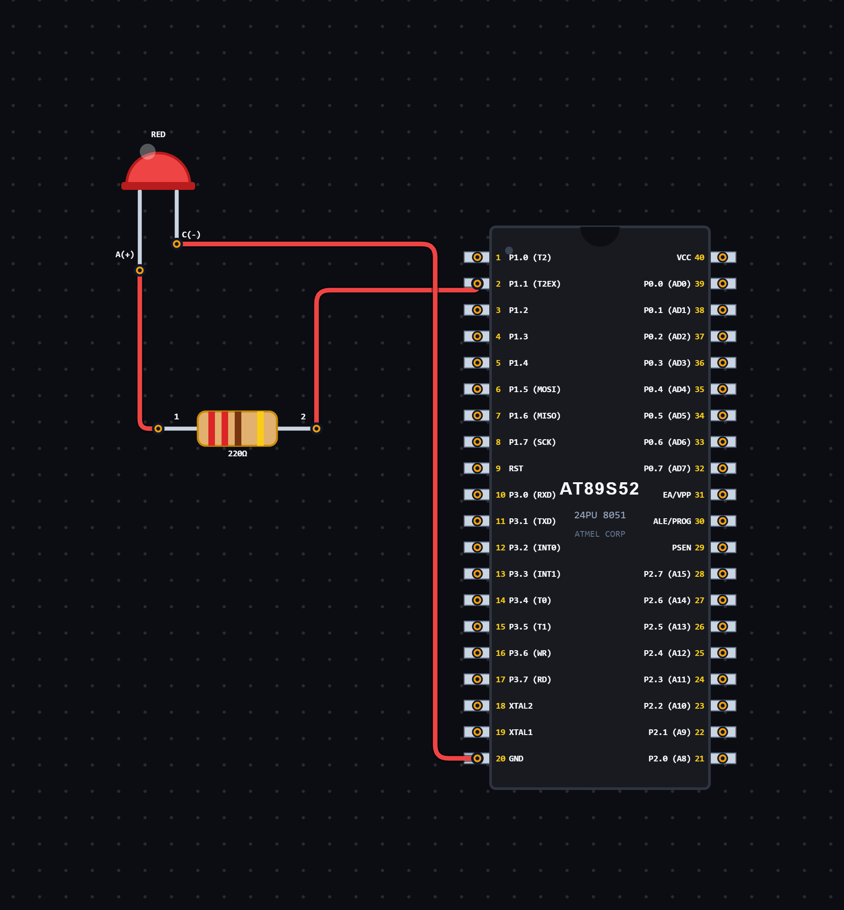

# EXPERIMENT DETAILS

**EXP:** CONTINUOUS ASSESSMENT 5

**DATE:** 14/08/2026

**NAME OF EXP:** Signal Generation Using Timer 1 Interrupts

**HARDWARE SETUP / PLATFORM:** 8051 Microcontroller + VS Code

---

## TASK 5B.3 : Signal Generation Using Timer 1 Interrupts

### 1. Circuit Diagram

The experiment demonstrates different signal generation techniques using Timer 1 interrupts of the 8051 microcontroller.

- **Microcontroller:** 8051
- **Timer:** Timer 1
- **Timer Mode:** Mode 1 (16-bit Timer Mode)
- **GPIO Port:** Port 1
- **GPIO Pins:** P1.0 and P1.1
- **Output Devices:** LEDs / Signal Output
- **Power Supply:** 5V DC

**Circuit Diagram:**

### 2. Core Logic / Pseudocode / Code Base

The experiment consists of three different signal generation programs using Timer 1 interrupts.

### A. Pulse Train Generation

**Working Principle:**

Timer 1 is configured in Mode 1 and generates periodic interrupts.

The Timer 1 interrupt service routine reloads the timer registers with the values `TH1 = 0xFC` and `TL1 = 0x66`.

A counter variable `i` is used to control the output signal. When `i` is zero, the output pin P1.1 is set HIGH. For the remaining counter values, the output is set LOW.

The counter increments after every interrupt and resets to zero when it reaches 8.

This produces a repeating pulse pattern.

**Pseudocode:**

1. Include the 8051 register definition header file.
2. Define P1.1 as the output pin.
3. Initialize the counter to zero.
4. Create the Timer 1 interrupt service routine.
5. Reload TH1 and TL1 whenever an interrupt occurs.
6. If the counter is zero, set the output HIGH.
7. Otherwise, set the output LOW.
8. Increment the counter.
9. Reset the counter when it reaches 8.
10. Configure Timer 1 in Mode 1.
11. Enable Timer 1 interrupts and global interrupts.
12. Start Timer 1 and continue execution.

**Code Base:**

- `reg51.h` provides the 8051 register definitions.
- `sbit out = P1^1` assigns P1.1 as the output pin.
- `TMOD = 0x10` configures Timer 1 in Mode 1.
- `TH1 = 0xFC` and `TL1 = 0x66` load the timer values.
- `ET1 = 1` enables Timer 1 interrupts.
- `EA = 1` enables global interrupts.
- `TR1 = 1` starts Timer 1.
- `void timer1(void) interrupt 3` defines the Timer 1 interrupt service routine.
- The counter `i` controls the repeating pulse pattern.

### B. Variable Duty Cycle Generation

**Working Principle:**

This program generates a PWM signal with a variable duty cycle using Timer 1 interrupts.

Timer 1 is configured in Mode 1 and generates periodic interrupts. During each interrupt, the timer registers are reloaded with `TH1 = 0xFF` and `TL1 = 0xF7`.

The counter variable `count` determines the PWM position within a cycle of 100 counts.

The LED connected to P1.0 is switched ON when `count` is less than the current duty cycle. Otherwise, it is switched OFF.

The duty cycle gradually increases from 0 to 100 and then decreases back to zero. This creates a gradual LED brightening and dimming effect.

**Pseudocode:**

1. Include the 8051 register definition header file.
2. Define P1.0 as the LED output pin.
3. Initialize the counter, duty cycle and fade counter.
4. Set the direction variable to 1.
5. Configure Timer 1 in Mode 1.
6. Load TH1 and TL1 with the initial timer values.
7. Enable Timer 1 interrupts and global interrupts.
8. Start Timer 1.
9. In the interrupt service routine:
   - Reload the timer registers.
   - Compare the counter with the duty cycle.
   - Turn the LED ON if the counter is less than the duty cycle.
   - Otherwise, turn the LED OFF.
10. Increment the counter.
11. When the counter reaches 100, reset it and increment the fade counter.
12. When the fade counter reaches 10, update the duty cycle.
13. Increase the duty cycle when brightening.
14. Decrease the duty cycle when dimming.
15. Reverse the direction at the minimum and maximum duty cycle.
16. Repeat continuously.

**Code Base:**

- `reg51.h` provides the 8051 register definitions.
- `sbit led = P1^0` assigns P1.0 as the LED output pin.
- `TMOD = 0x10` configures Timer 1 in Mode 1.
- `TH1 = 0xFF` and `TL1 = 0xF7` load the timer values.
- `ET1 = 1` enables Timer 1 interrupts.
- `EA = 1` enables global interrupts.
- `TR1 = 1` starts Timer 1.
- `count` tracks the PWM position within a cycle of 100 counts.
- `duty` determines the LED ON duration.
- `fcount` controls how frequently the duty cycle is updated.
- `dir` determines whether the duty cycle is increasing or decreasing.
- The interrupt service routine updates the LED output and duty cycle.

### C. Burst Signal Generation

**Working Principle:**

This program generates a burst signal using Timer 1 interrupts.

Timer 1 is configured in Mode 1 and generates periodic interrupts using the reload values `TH1 = 0xFC` and `TL1 = 0x66`.

The counter variable `i` controls three different stages of the output signal:

- **Stage 1 (0–9):** The output pin P1.1 toggles between HIGH and LOW.
- **Stage 2 (10–19):** The output pin remains LOW.
- **Stage 3 (20–29):** The output pin toggles between HIGH and LOW again.

Once the counter reaches 30, it resets to zero and the sequence repeats.

**Pseudocode:**

1. Include the 8051 register definition header file.
2. Define P1.1 as the output pin.
3. Initialize the counter to zero.
4. Configure Timer 1 in Mode 1.
5. Load TH1 and TL1 with the initial timer values.
6. Enable Timer 1 interrupts and global interrupts.
7. Start Timer 1.
8. In the interrupt service routine:
   - Reload the timer registers.
   - If the counter is less than 10, toggle the output.
   - If the counter is between 10 and 19, set the output LOW.
   - Otherwise, toggle the output.
9. Increment the counter.
10. Reset the counter when it reaches 30.
11. Repeat continuously to generate the burst signal.

**Code Base:**

- `reg51.h` provides the 8051 register definitions.
- `sbit out = P1^1` assigns P1.1 as the output pin.
- `TMOD = 0x10` configures Timer 1 in Mode 1.
- `TH1 = 0xFC` and `TL1 = 0x66` load the timer values.
- `ET1 = 1` enables Timer 1 interrupts.
- `EA = 1` enables global interrupts.
- `TR1 = 1` starts Timer 1.
- `void timer1(void) interrupt 3` defines the Timer 1 interrupt service routine.
- The counter `i` determines the different stages of the burst signal.
- `out = ~out` toggles the output pin between HIGH and LOW.

### 3. Inference

The experiment demonstrates different signal generation techniques using Timer 1 interrupts of the 8051 microcontroller.

The three programs demonstrate:

1. **Pulse Train Generation:** Producing a repeating pulse pattern using a counter.
2. **Variable Duty Cycle Generation:** Controlling LED brightness by gradually changing the PWM duty cycle.
3. **Burst Signal Generation:** Producing a signal with alternating active and inactive intervals.

The experiment provides an understanding of Timer 1 configuration, interrupt handling, timer overflow, PWM generation, duty cycle control and digital signal generation using Embedded C programming.