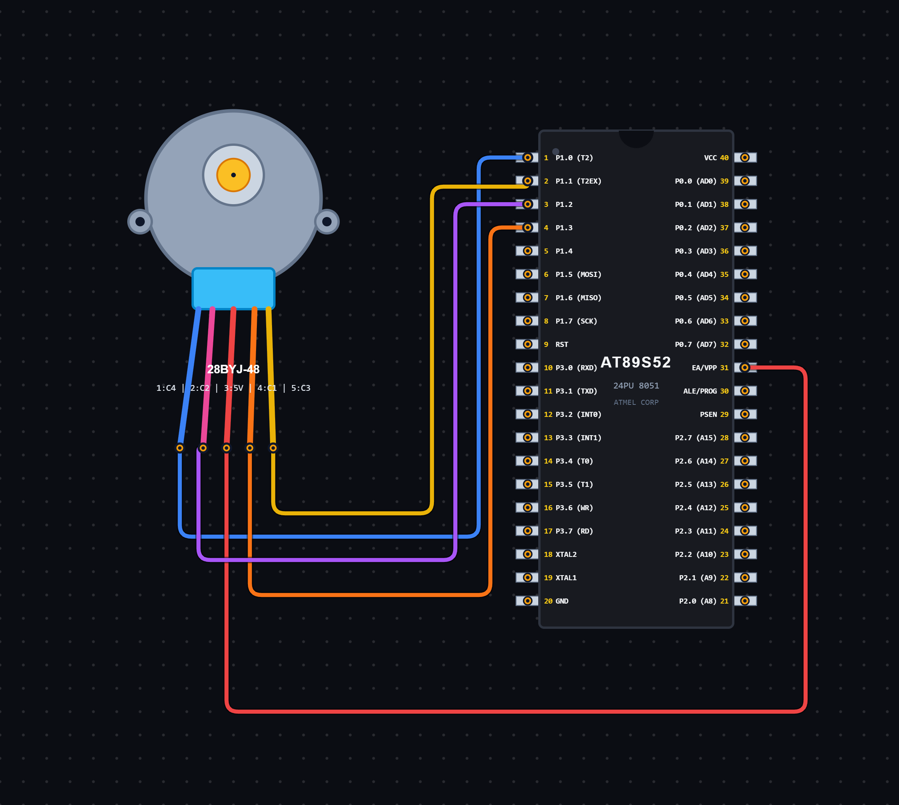

# EXPERIMENT DETAILS

**EXP:** CONTINUOUS ASSESSMENT 5

**DATE:** 14/08/2026

**NAME OF EXP:** Stepper Motor Speed Control Using Keypad

**HARDWARE SETUP / PLATFORM:** 8051 Microcontroller + VS Code

---

## TASK 5C : Stepper Motor Control Using Keypad and Timer 0

### 1. Circuit Diagram

The experiment demonstrates stepper motor control using an 8051 microcontroller. A 4×4 matrix keypad is used to select the motor speed, and Timer 0 generates periodic interrupts to control the stepping sequence.

- **Microcontroller:** 8051
- **Input Device:** 4×4 Matrix Keypad
- **Keypad Port:** Port 2
- **Motor Control Port:** Port 1
- **Motor Output Pins:** P1.0 – P1.3
- **Timer:** Timer 0
- **Timer Mode:** Mode 1 (16-bit Timer Mode)
- **Peripheral:** Stepper Motor with suitable driver circuit
- **Power Supply:** As required by the motor and driver

**Circuit Diagram:**

### 2. Core Logic / Pseudocode / Code Base

**Working Principle:**

The experiment uses a 4×4 matrix keypad to control the speed of a stepper motor connected to the 8051 microcontroller.

The keypad is scanned through Port 2 by checking its rows and columns. When one of the keys 1, 2 or 3 is pressed, the corresponding speed value is selected.

Timer 0 is configured in Mode 1 and generates periodic interrupts. During each interrupt, a counter is incremented. When the counter reaches the selected speed value, the motor stepping function is executed.

The `motor()` function sends a stepping sequence to Port 1 by shifting the step pattern. This produces continuous motor rotation.

**Speed Selection:**

| Key Pressed | Speed Variable |
|---|---:|
| 1 | 1 |
| 2 | 5 |
| 3 | 10 |

A smaller speed variable causes the motor stepping function to execute more frequently, while a larger value increases the interval between steps.

**Pseudocode:**

1. Include the 8051 register definition header file.
2. Initialize the counter to zero.
3. Set the initial speed value to 1.
4. Initialize the step sequence to `0x08`.
5. Define the keypad row and column pin positions.
6. Scan the keypad by activating one row at a time.
7. Identify whether key 1, 2 or 3 is pressed.
8. Update the speed variable based on the pressed key.
9. Configure Timer 0 in Mode 1 using the TMOD register.
10. Load TH0 and TL0 with the initial timer values.
11. Enable Timer 0 interrupts and global interrupts.
12. Start Timer 0.
13. In the Timer 0 interrupt service routine:
    - Reload TH0 and TL0.
    - Increment the counter.
    - Check whether the counter has reached the selected speed value.
14. If the counter reaches the selected value:
    - Reset the counter.
    - Execute the motor stepping function.
15. Shift the step pattern to generate the next motor step.
16. Repeat continuously to control the motor rotation.

**Code Base:**

The program is written in Embedded C for the 8051 microcontroller.

- `reg51.h` provides the 8051 register definitions.
- `count` stores the number of timer interrupts.
- `speed` determines how frequently the motor stepping function is executed.
- `step` stores the current motor stepping pattern.
- `keypad()` scans the keypad rows and columns to identify the pressed key.
- `rowpin[]` stores the keypad row pin positions.
- `colpin[]` stores the keypad column pin positions.
- `setspeed()` updates the motor speed based on the selected keypad key.
- `motor()` sends the stepping pattern to Port 1 and shifts the pattern for the next step.
- `TMOD = 0x01` configures Timer 0 in Mode 1 (16-bit timer mode).
- `TH0 = 0xDC` and `TL0 = 0x00` load the initial timer values.
- `ET0 = 1` enables Timer 0 interrupts.
- `EA = 1` enables global interrupts.
- `TR0 = 1` starts Timer 0.
- `void timer0(void) interrupt 1` defines the Timer 0 interrupt service routine.

### 3. Inference

The experiment demonstrates stepper motor control using keypad input and Timer 0 interrupts of the 8051 microcontroller.

It provides an understanding of matrix keypad scanning, timer configuration, interrupt handling, step sequence generation and motor speed control using Embedded C programming.

The motor speed can be varied by pressing different keys on the keypad, demonstrating the interfacing of input devices and motor control peripherals with a microcontroller.