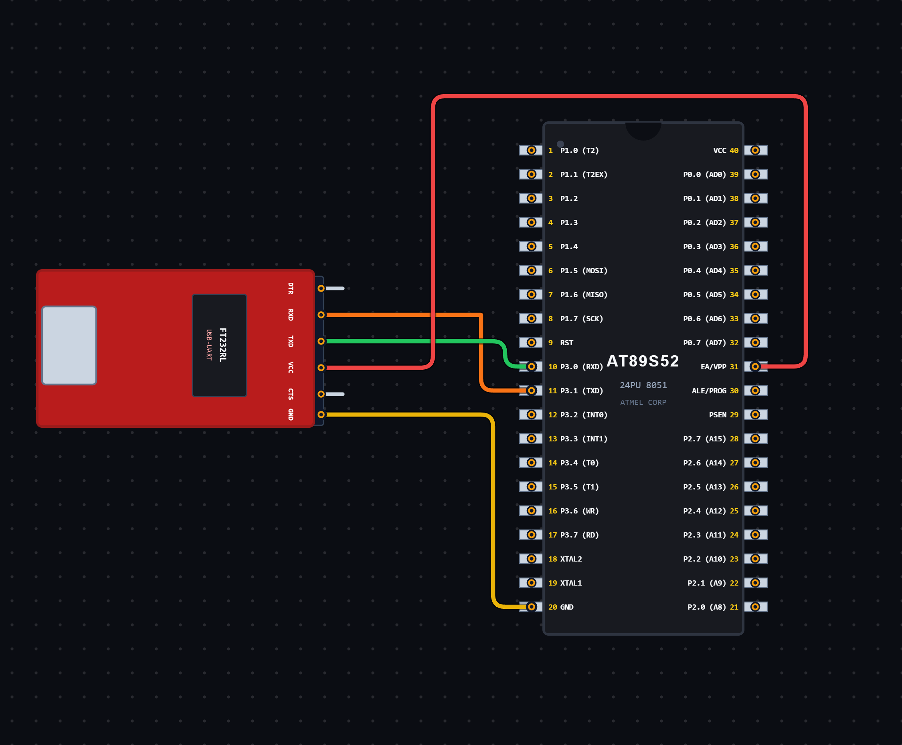

# EXPERIMENT DETAILS

**EXP:** CONTINUOUS ASSESSMENT 6

**DATE:** 21/08/2026

**NAME OF EXP:** UART Serial Communication – Data Transmission

**HARDWARE SETUP / PLATFORM:** 8051 Microcontroller + VS Code

---

## TASK 6A : UART Serial Data Transmission

### 1. Circuit Diagram

The experiment demonstrates serial data transmission using the UART peripheral of the 8051 microcontroller.

- **Microcontroller:** 8051
- **Communication Protocol:** UART
- **Serial Communication Mode:** Mode 1 (8-bit UART)
- **Baud Rate:** 9600 bps (with a typical 11.0592 MHz crystal)
- **Timer:** Timer 1
- **Timer Mode:** Mode 2 (8-bit Auto-Reload)
- **Data Transmitted:** Character 'A'
- **Communication Pin:** TXD (P3.1)

**Circuit Diagram:**

### 2. Core Logic / Pseudocode / Code Base

**Working Principle:**

The experiment uses the UART serial communication peripheral of the 8051 microcontroller to continuously transmit the character 'A'.

Timer 1 is configured in Mode 2 (8-bit auto-reload mode) to generate the baud rate required for serial communication.

The SCON register is configured with `0x50`, which selects UART Mode 1 and enables reception.

The character 'A' is loaded into the SBUF register for transmission. The program continuously checks the TI (Transmit Interrupt) flag to determine when transmission is complete.

Once the TI flag becomes HIGH, it is cleared so that the next character can be transmitted.

**Pseudocode:**

1. Include the 8051 register definition header file.
2. Configure Timer 1 in Mode 2 using the TMOD register.
3. Load TH1 with `0xFD` to set the baud rate reload value.
4. Configure the SCON register to `0x50`.
5. Start Timer 1 using TR1.
6. Enter an infinite loop.
7. Load the character 'A' into the SBUF register.
8. Wait until the TI flag becomes HIGH.
9. Clear the TI flag.
10. Repeat continuously to transmit the character 'A'.

**Code Base:**

The program is written in Embedded C for the 8051 microcontroller.

- `reg51.h` provides the 8051 register definitions.
- `TMOD = 0x20` configures Timer 1 in Mode 2 (8-bit auto-reload mode).
- `TH1 = 0xFD` sets the timer reload value for baud rate generation.
- `SCON = 0x50` configures UART Mode 1 and enables serial reception.
- `TR1 = 1` starts Timer 1.
- `SBUF = 'A'` loads the character 'A' into the serial buffer for transmission.
- `TI` is the transmit interrupt flag, which indicates completion of data transmission.
- `TI = 0` clears the transmit flag before the next transmission.

### 3. Inference

The experiment demonstrates UART-based serial data transmission using the 8051 microcontroller.

The character 'A' is continuously transmitted through the TXD pin using the UART peripheral.

The experiment provides an understanding of UART configuration, baud rate generation using Timer 1, serial buffer operation and transmit flag handling using Embedded C programming.