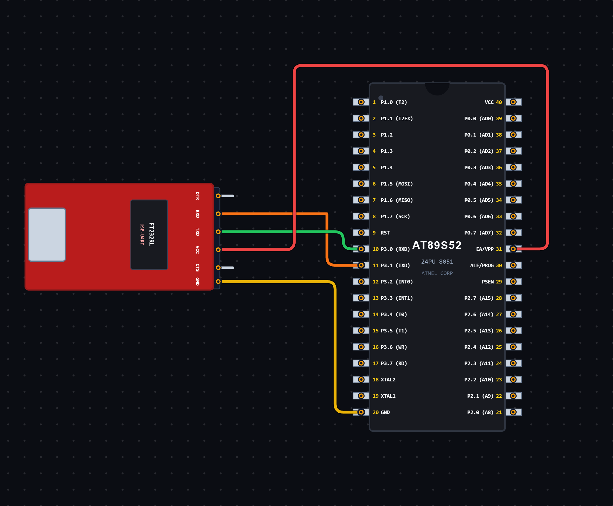

# EXPERIMENT DETAILS

**EXP:** CONTINUOUS ASSESSMENT 6

**DATE:** 21/08/2026

**NAME OF EXP:** UART Serial Communication – Data Reception and Echo Transmission

**HARDWARE SETUP / PLATFORM:** 8051 Microcontroller + VS Code

---

## TASK 6B : UART Serial Data Reception and Transmission

### 1. Circuit Diagram

The experiment demonstrates serial data reception and transmission using the UART peripheral of the 8051 microcontroller.

- **Microcontroller:** 8051
- **Communication Protocol:** UART
- **Serial Communication Mode:** Mode 1 (8-bit UART)
- **Timer:** Timer 1
- **Timer Mode:** Mode 2 (8-bit Auto-Reload)
- **Baud Rate:** 4800 bps (with a typical 11.0592 MHz crystal)
- **Communication Pins:**
  - RXD – P3.0
  - TXD – P3.1
- **Operation:** Receive a character and transmit the same character back.

**Circuit Diagram:**

### 2. Core Logic / Pseudocode / Code Base

**Working Principle:**

The experiment uses UART serial communication to receive a character from an external device and transmit the same character back.

Timer 1 is configured in Mode 2 (8-bit auto-reload mode) to generate the baud rate required for serial communication.

The SCON register is configured with `0x50`, which selects UART Mode 1 and enables serial reception.

The program continuously checks the RI (Receive Interrupt) flag to identify when a character has been received.

Once RI becomes HIGH, the received character is read from the SBUF register and stored in the variable `ch`. The RI flag is then cleared.

The received character is loaded back into SBUF for transmission. The program waits until the TI (Transmit Interrupt) flag becomes HIGH, indicating that transmission is complete. The TI flag is then cleared.

This process repeats continuously, allowing the microcontroller to echo received characters.

**Pseudocode:**

1. Include the 8051 register definition header file.
2. Declare a character variable `ch`.
3. Configure Timer 1 in Mode 2 using the TMOD register.
4. Load TH1 with `0xFA` to set the baud rate reload value.
5. Configure the SCON register to `0x50`.
6. Start Timer 1 using TR1.
7. Enter an infinite loop.
8. Wait until the RI flag becomes HIGH.
9. Read the received character from SBUF.
10. Store the received character in `ch`.
11. Clear the RI flag.
12. Load the received character into SBUF for transmission.
13. Wait until the TI flag becomes HIGH.
14. Clear the TI flag.
15. Repeat continuously.

**Code Base:**

The program is written in Embedded C for the 8051 microcontroller.

- `reg51.h` provides the 8051 register definitions.
- `char ch` stores the received character.
- `TMOD = 0x20` configures Timer 1 in Mode 2 (8-bit auto-reload mode).
- `TH1 = 0xFA` sets the timer reload value for baud rate generation.
- `SCON = 0x50` configures UART Mode 1 and enables serial reception.
- `TR1 = 1` starts Timer 1.
- `RI` is the receive interrupt flag, which indicates that a character has been received.
- `SBUF` is used to read received data and load data for transmission.
- `RI = 0` clears the receive flag.
- `TI` is the transmit interrupt flag, which indicates completion of data transmission.
- `TI = 0` clears the transmit flag before the next transmission.

### 3. Inference

The experiment demonstrates UART-based serial data reception and transmission using the 8051 microcontroller.

The microcontroller receives a character through the RXD pin and transmits the same character through the TXD pin.

The experiment provides an understanding of UART configuration, baud rate generation using Timer 1, serial data reception, transmission and flag handling using Embedded C programming.