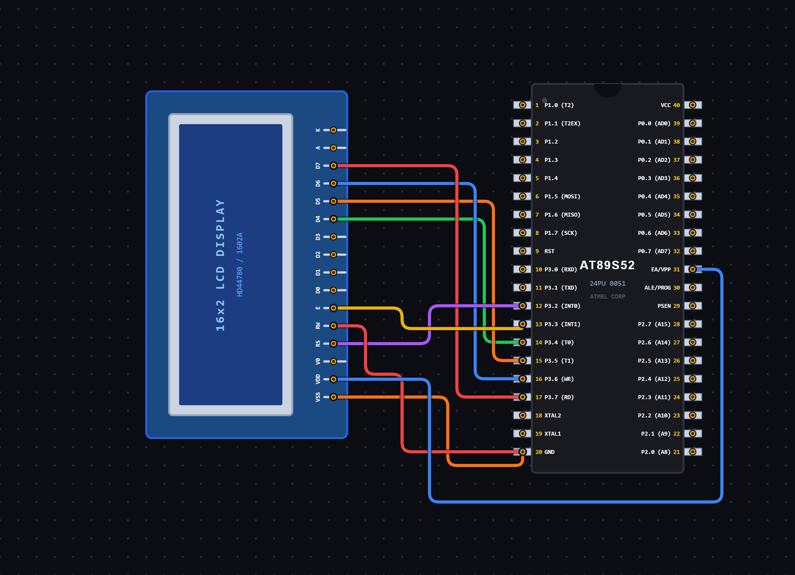

# EXPERIMENT DETAILS

**EXP:** CONTINUOUS ASSESSMENT 7

**DATE:** 28/08/2026

**NAME OF EXP:** Interfacing 16×2 LCD with 8051 Microcontroller

**HARDWARE SETUP / PLATFORM:** 8051 Microcontroller + VS Code

---

## TASK 7A : 16×2 LCD Interfacing in 4-bit Mode

### 1. Circuit Diagram

The experiment demonstrates interfacing a 16×2 LCD with the 8051 microcontroller using 4-bit communication mode.

- **Microcontroller:** 8051
- **Display:** 16×2 LCD
- **Communication Mode:** 4-bit Mode
- **Control Pins:**
  - RS – P3.2
  - EN – P3.3
- **Data Pins:** P3.4 – P3.7 (D4–D7)
- **Power Supply:** 5V DC

**Circuit Diagram:**

### 2. Core Logic / Pseudocode / Code Base

**Working Principle:**

The experiment uses a 16×2 LCD to display characters and strings using the 8051 microcontroller.

The LCD is operated in 4-bit mode, where data is transmitted in two separate nibbles instead of sending all eight bits simultaneously.

The RS pin is used to select between command and data operations. When RS is LOW, the LCD receives a command. When RS is HIGH, the LCD receives display data.

The EN pin is used to enable the LCD to accept the transmitted nibble.

Initially, the LCD is initialized using a sequence of commands. The program then displays individual characters 'A' and 'B', followed by the strings "ABC" and "DEF" on the first and second rows.

**Pseudocode:**

1. Include the 8051 register definition header file.
2. Define RS and EN control pins.
3. Create a delay function using nested loops.
4. Create an LCD pulse function to generate an enable pulse.
5. Create a function to send a 4-bit nibble to the LCD.
6. Create a command function:
   - Set RS LOW.
   - Send the higher nibble.
   - Send the lower nibble.
7. Create a data function:
   - Set RS HIGH.
   - Send the higher nibble.
   - Send the lower nibble.
8. Initialize the LCD in 4-bit mode.
9. Configure the LCD display settings using commands.
10. Move the cursor to the first row and display 'A'.
11. Move the cursor to the second row and display 'B'.
12. Display the string "ABC" on the first row.
13. Display the string "DEF" on the second row.
14. Enter an infinite loop.

**Code Base:**

The program is written in Embedded C for the 8051 microcontroller.

- `reg51.h` provides the 8051 register definitions.
- `sbit RS = P3^2` assigns the Register Select pin.
- `sbit EN = P3^3` assigns the Enable pin.
- `delay_ms()` generates software delays.
- `lcd_pulse()` generates an enable pulse to transfer data to the LCD.
- `lcd_send_nibble()` sends a 4-bit data value to the LCD.
- `lcd_cmd()` sends LCD commands with RS set to LOW.
- `lcd_putc()` sends individual characters with RS set to HIGH.
- `lcd_init()` initializes the LCD in 4-bit mode.
- `lcd_puts()` displays a string character by character.
- `lcd_cmd(0x80)` moves the cursor to the first row.
- `lcd_cmd(0xC0)` moves the cursor to the second row.
- `lcd_cmd(0x28)` configures the LCD for 4-bit, 2-line operation.
- `lcd_cmd(0x0C)` turns ON the display and turns OFF the cursor.
- `lcd_cmd(0x06)` configures automatic cursor increment.
- `lcd_cmd(0x01)` clears the display.

### 3. Inference

The experiment demonstrates successful interfacing of a 16×2 LCD with the 8051 microcontroller using 4-bit communication mode.

It provides an understanding of LCD initialization, command transmission, data transmission, cursor positioning, character display and string display using Embedded C programming.

The experiment also demonstrates how fewer microcontroller pins can be used for LCD communication through 4-bit mode.