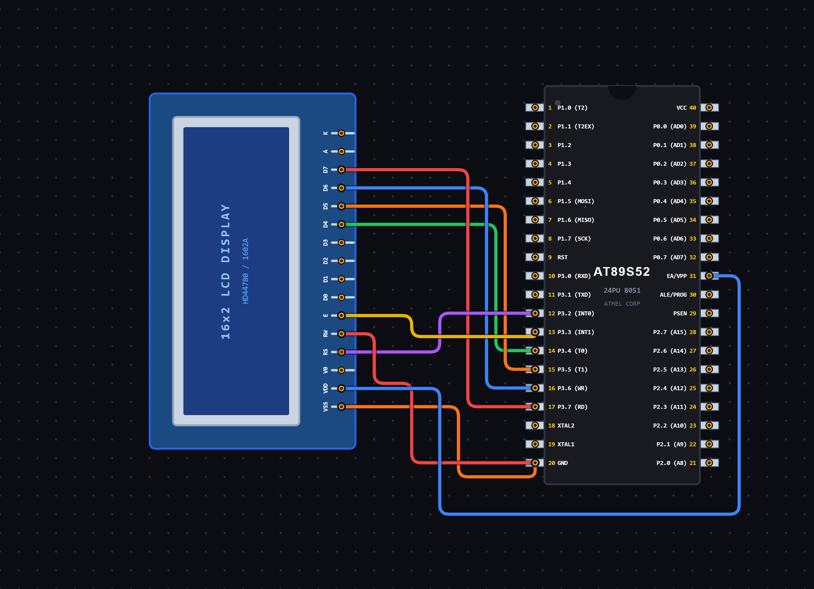

# EXPERIMENT DETAILS

**EXP:** CONTINUOUS ASSESSMENT 7

**DATE:** 28/08/2026

**NAME OF EXP:** LCD Cursor Positioning and Number Display Using 8051

**HARDWARE SETUP / PLATFORM:** 8051 Microcontroller + VS Code

---

## TASK 7B : LCD Cursor Positioning and Number Display

### 1. Circuit Diagram

The experiment demonstrates interfacing a 16×2 LCD with the 8051 microcontroller in 4-bit mode. It uses cursor positioning functions to display text and numeric values at specific locations on the LCD.

- **Microcontroller:** 8051
- **Display:** 16×2 LCD
- **Communication Mode:** 4-bit Mode
- **Control Pins:**
  - RS – P3.2
  - EN – P3.3
- **Data Pins:** P3.4 – P3.7 (D4–D7)
- **Power Supply:** 5V DC

**Circuit Diagram:**

### 2. Core Logic / Pseudocode / Code Base

**Working Principle:**

The experiment uses a 16×2 LCD to display text and numbers at specific cursor positions.

The LCD is initialized in 4-bit mode using the required initialization commands. The RS pin selects between command and data operations, while the EN pin generates the enable pulse for data transfer.

The `lcd_goto()` function is used to position the cursor at a specified row and column.

The `lcd_print_number()` function converts an unsigned integer into individual decimal digits and displays them on the LCD without leading zeros.

In the main function, the text "HI" is displayed on the first row, "There" is displayed on the second row starting from column 3, and the number 13 is displayed on the first row starting from column 8.

**Pseudocode:**

1. Include the 8051 register definition header file.
2. Define RS and EN control pins.
3. Create a delay function using nested loops.
4. Create an LCD pulse function to generate the enable pulse.
5. Create a function to send 4-bit data to the LCD.
6. Create separate functions for sending commands and characters.
7. Initialize the LCD in 4-bit mode.
8. Create the `lcd_puts()` function to display strings.
9. Create the `lcd_goto()` function to position the cursor:
   - Use command `0x80 + col` for the first row.
   - Use command `0xC0 + col` for the second row.
10. Create the `lcd_print_number()` function to display integer values digit by digit.
11. Initialize the LCD.
12. Position the cursor at row 0, column 0 and display "HI".
13. Position the cursor at row 1, column 3 and display "There".
14. Position the cursor at row 0, column 8 and display the number 13.
15. Enter an infinite loop.

**Code Base:**

The program is written in Embedded C for the 8051 microcontroller.

- `reg51.h` provides the 8051 register definitions.
- `sbit RS = P3^2` assigns the Register Select pin.
- `sbit EN = P3^3` assigns the Enable pin.
- `delay_ms()` generates software delays.
- `lcd_pulse()` generates the enable pulse required for LCD communication.
- `lcd_send_nibble()` sends a 4-bit value to the LCD.
- `lcd_cmd()` sends LCD commands with RS set to LOW.
- `lcd_putc()` sends individual characters with RS set to HIGH.
- `lcd_init()` initializes the LCD in 4-bit mode.
- `lcd_puts()` displays a string character by character.
- `lcd_goto(row, col)` positions the LCD cursor at the specified row and column.
- `lcd_print_number()` converts an unsigned integer into individual decimal digits and displays them without leading zeros.
- `lcd_cmd(0x80 + col)` selects a position on the first row.
- `lcd_cmd(0xC0 + col)` selects a position on the second row.

### 3. Inference

The experiment demonstrates LCD interfacing, cursor positioning, string display and numeric data display using the 8051 microcontroller.

It provides an understanding of 4-bit LCD communication, LCD command handling, cursor addressing and integer-to-character conversion using Embedded C programming.

The experiment also demonstrates how text and numeric values can be displayed at different positions on a 16×2 LCD.