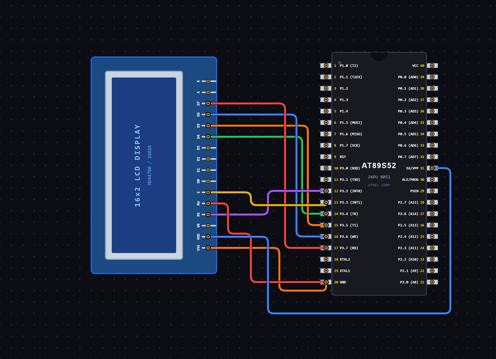

# EXPERIMENT DETAILS

**EXP:** CONTINUOUS ASSESSMENT 7

**DATE:** 28/08/2026

**NAME OF EXP:** Keypad Controlled Character Movement on LCD

**HARDWARE SETUP / PLATFORM:** 8051 Microcontroller + VS Code

---

## TASK 7C : Keypad Controlled Character Movement on LCD

### 1. Circuit Diagram

The experiment demonstrates controlling the movement of a character on a 16×2 LCD using a 4×4 matrix keypad and the 8051 microcontroller.

- **Microcontroller:** 8051
- **Display:** 16×2 LCD
- **Input Device:** 4×4 Matrix Keypad
- **LCD Communication:** 4-bit Mode
- **LCD Control Pins:**
  - RS – P3.2
  - EN – P3.3
- **LCD Data Pins:** P3.4 – P3.7 (D4–D7)
- **Keypad Port:** Port 2
- **Power Supply:** 5V DC

**Circuit Diagram:**

### 2. Core Logic / Pseudocode / Code Base

**Working Principle:**

The experiment uses a 4×4 matrix keypad to control the movement of a `*` character on a 16×2 LCD.

The keypad is scanned by activating one row at a time and checking the column inputs to identify the pressed key.

The keys 2, 4, 6 and 8 are assigned movement operations:

- **Key 2:** Moves the character down to the second row.
- **Key 4:** Moves the character one position to the left.
- **Key 6:** Moves the character one position to the right.
- **Key 8:** Moves the character up to the first row.

The current character position is stored using two variables, `row` and `col`.

Before moving the character, the previous position is cleared by displaying a blank space. The new position is then calculated and the `*` character is displayed.

The character wraps around when it reaches the left or right boundary of the LCD.

**Key Functions:**

| Key | Operation |
|---|---|
| 2 | Move Down |
| 4 | Move Left |
| 6 | Move Right |
| 8 | Move Up |

**Pseudocode:**

1. Include the 8051 register definition header file.
2. Define the LCD control pins RS and EN.
3. Define the keypad row and column pins.
4. Initialize the row and column position variables to zero.
5. Create a delay function.
6. Create a keypad scanning function to identify the pressed key.
7. Initialize the LCD in 4-bit mode.
8. Create the `lcd_goto()` function to position the LCD cursor.
9. Create the `move_character()` function.
10. Display the initial `*` character at row 0, column 0.
11. Enter an infinite loop.
12. Scan the keypad for a pressed key.
13. If key 2 is pressed, move the character to the other row.
14. If key 8 is pressed, move the character to the other row.
15. If key 6 is pressed, move the character one column to the right.
16. If key 4 is pressed, move the character one column to the left.
17. Clear the previous character position.
18. Display the `*` character at the updated position.
19. Repeat continuously.

**Code Base:**

The program is written in Embedded C for the 8051 microcontroller.

- `reg51.h` provides the 8051 register definitions.
- `sbit RS = P3^2` assigns the Register Select pin.
- `sbit EN = P3^3` assigns the Enable pin.
- `c1`, `c2`, `c3` and `c4` define the keypad column pins.
- `r1`, `r2`, `r3` and `r4` define the keypad row pins.
- `delay_ms()` generates software delays.
- `keypad_scan()` scans the keypad and identifies the pressed movement key.
- `lcd_pulse()` generates the enable pulse for LCD communication.
- `lcd_send_nibble()` sends 4-bit data to the LCD.
- `lcd_cmd()` sends LCD commands.
- `lcd_putc()` displays individual characters.
- `lcd_init()` initializes the LCD in 4-bit mode.
- `lcd_goto()` positions the cursor at the specified row and column.
- `move_character()` updates the character position based on the pressed key.
- `row` stores the current LCD row position.
- `col` stores the current LCD column position.

### 3. Inference

The experiment demonstrates keypad-based character movement on a 16×2 LCD using the 8051 microcontroller.

It provides an understanding of matrix keypad scanning, LCD interfacing, cursor positioning, boundary handling and real-time input-based control using Embedded C programming.

The experiment also demonstrates how input devices can be used to control the position of displayed characters on an LCD.