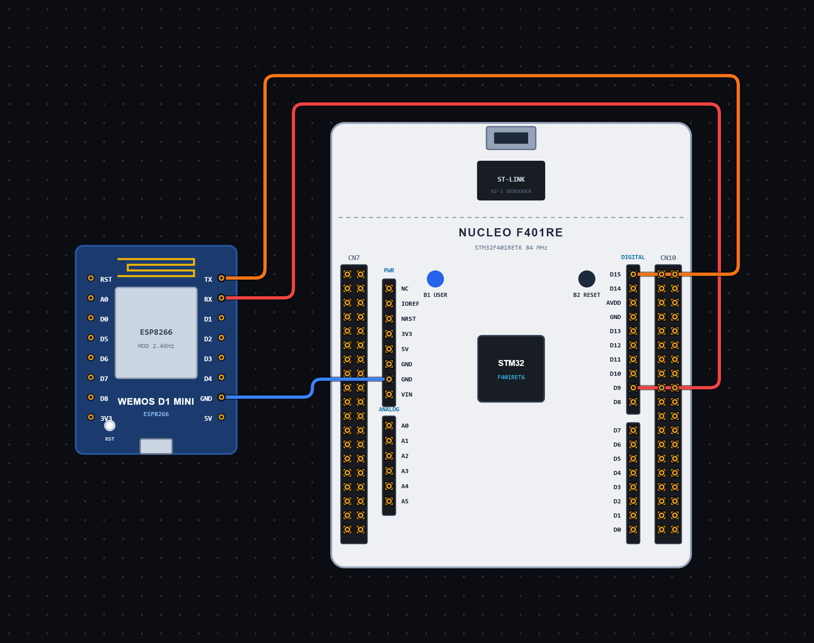

# EXPERIMENT DETAILS

**EXP:** CONTINUOUS ASSESSMENT 10

**DATE:** 09/10/2026

**NAME OF EXP:** ESP Module Communication using UART AT Commands

**HARDWARE SETUP / PLATFORM:** STM32 Microcontroller + ESP Module + STM32CubeIDE / HAL Library

---

## TASK 10A : Sending AT Commands to ESP Module using STM32

### 1. Circuit Diagram

The experiment demonstrates serial communication between the STM32 microcontroller and an ESP module using UART AT commands.

- **Microcontroller:** STM32
- **Communication Peripheral:** USART6
- **Communication Module:** ESP Module
- **Communication Mode:** UART Transmit and Receive
- **Baud Rate:** 115200
- **Word Length:** 8 Bits
- **Stop Bits:** 1
- **Parity:** None
- **Hardware Flow Control:** Disabled
- **Programming Environment:** STM32CubeIDE

**Circuit Diagram:**

### 2. Core Logic / Pseudocode / Code Base

**Working Principle:**

The experiment uses USART6 of the STM32 microcontroller to communicate with an ESP module through AT commands.

The USART6 peripheral is configured with a baud rate of 115200, 8-bit word length, one stop bit and no parity.

After initializing the system clock, GPIO and USART6 peripherals, the STM32 sends the AT command `"AT\r\n"` to the ESP module using the `HAL_UART_Transmit()` function.

A delay of 1000 milliseconds is provided after transmission to allow the ESP module to process the command and respond.

**Pseudocode:**

1. Initialize the HAL library using `HAL_Init()`.
2. Configure the system clock using `SystemClock_Config()`.
3. Initialize GPIO and USART6 peripherals.
4. Create a receive buffer and initialize the received data length.
5. Define the AT command as `"AT\r\n"`.
6. Transmit the AT command through USART6 using `HAL_UART_Transmit()`.
7. Wait for 1000 milliseconds using `HAL_Delay()`.
8. Enter an infinite loop.

**Code Base:**

The program is written in Embedded C using the STM32 HAL library.

- `main.h` provides the required STM32 definitions and HAL declarations.
- `stdio.h` provides standard input/output function declarations.
- `string.h` provides string-handling functions.
- `stdlib.h` provides standard utility functions.
- `UART_HandleTypeDef huart6` defines the UART handle for USART6.
- `HAL_Init()` initializes the HAL library and system tick.
- `SystemClock_Config()` configures the system clock using an external high-speed clock source and PLL.
- `MX_GPIO_Init()` enables the required GPIO port clocks.
- `MX_USART6_UART_Init()` configures USART6 for serial communication.
- `HAL_UART_Transmit()` sends the AT command to the ESP module.
- `HAL_Delay()` provides a 1000-millisecond delay after sending the command.
- `rx[512]` is declared as a buffer for receiving data.
- `rxLen` stores the received data length.
- `cmd1[]` stores the AT command `"AT\r\n"`.

### 3. Inference

The experiment demonstrates UART communication between the STM32 microcontroller and an ESP module using AT commands.

The STM32 initializes USART6 and transmits the basic `AT` command to the ESP module. This is used to initiate communication and check the module's response.

The experiment provides an understanding of UART peripheral configuration, serial communication, AT command transmission and interfacing an ESP module with an STM32 microcontroller.