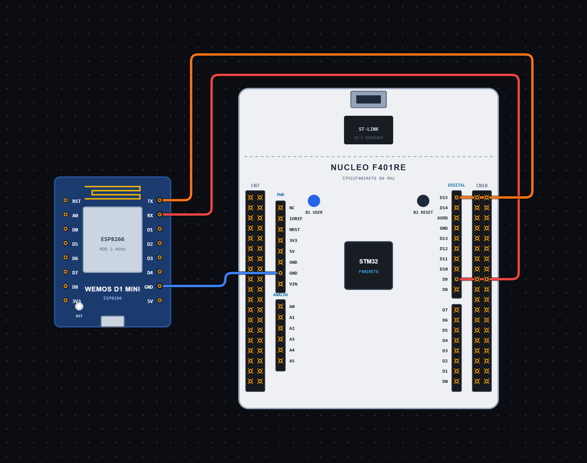

# EXPERIMENT DETAILS

**EXP:** CONTINUOUS ASSESSMENT 10

**DATE:** 09/10/2026

**NAME OF EXP:** Wi-Fi Configuration and Connection using ESP Module and STM32

**HARDWARE SETUP / PLATFORM:** STM32 Microcontroller + ESP Module + STM32CubeIDE / HAL Library

---

## TASK 10C : Wi-Fi Configuration using ESP AT Commands

### 1. Circuit Diagram

The experiment demonstrates configuring an ESP module and connecting it to a Wi-Fi network using AT commands sent from the STM32 microcontroller.

- **Microcontroller:** STM32
- **Communication Peripheral:** USART6
- **Communication Module:** ESP Module
- **Communication Mode:** UART Transmit and Receive
- **Baud Rate:** 115200
- **Word Length:** 8 Bits
- **Stop Bits:** 1
- **Parity:** None
- **Hardware Flow Control:** Disabled
- **Programming Environment:** STM32CubeIDE

**Circuit Diagram:**

### 2. Core Logic / Pseudocode / Code Base

**Working Principle:**

The experiment uses USART6 to communicate with the ESP module through AT commands.

After initializing the STM32 peripherals, the program sends a sequence of AT commands to configure the ESP module and establish a Wi-Fi connection.

The `AT` command checks communication with the ESP module. The `AT+CWMODE=1` command configures the module in Station mode, allowing it to connect to an existing Wi-Fi network.

The `AT+CWLAP` command scans and lists available Wi-Fi networks. The `AT+CWJAP` command connects the ESP module to the specified Wi-Fi network using its SSID and password.

Finally, the `AT+CIFSR` command retrieves the IP address assigned to the ESP module.

The `HAL_UART_Transmit()` function sends each command, while `HAL_UARTEx_ReceiveToIdle()` receives the responses from the ESP module.

**AT Commands Used:**

| AT Command | Purpose |
| ----------------------------------- | -------------------------------- |
| `AT` | Checks communication with the ESP module |
| `AT+CWMODE=1` | Configures the ESP module in Station mode |
| `AT+CWLAP` | Scans for available Wi-Fi networks |
| `AT+CWJAP="SSID","PASSWORD"` | Connects to the specified Wi-Fi network |
| `AT+CIFSR` | Retrieves the IP address of the ESP module |

**Pseudocode:**

1. Initialize the HAL library using `HAL_Init()`.
2. Configure the system clock using `SystemClock_Config()`.
3. Initialize GPIO and USART6 peripherals.
4. Create a receive buffer to store responses from the ESP module.
5. Send the `AT` command to check communication.
6. Receive the response using `HAL_UARTEx_ReceiveToIdle()`.
7. Wait for 2000 milliseconds.
8. Send the `AT+CWMODE=1` command to configure Station mode.
9. Receive the response from the ESP module.
10. Wait for 2000 milliseconds.
11. Send the `AT+CWLAP` command to scan available Wi-Fi networks.
12. Receive the scan results.
13. Wait for 10000 milliseconds.
14. Send the `AT+CWJAP` command with the Wi-Fi SSID and password.
15. Receive the connection response.
16. Wait for 5000 milliseconds.
17. Send the `AT+CIFSR` command to retrieve the assigned IP address.
18. Receive the response from the ESP module.
19. Wait for 5000 milliseconds.
20. Enter an infinite loop.

**Code Base:**

The program is written in Embedded C using the STM32 HAL library.

- `main.h` provides the required STM32 definitions and HAL declarations.
- `stdio.h` provides standard input/output function declarations.
- `string.h` provides string-handling functions.
- `stdlib.h` provides standard utility functions.
- `UART_HandleTypeDef huart6` defines the UART handle for USART6.
- `HAL_Init()` initializes the HAL library and system tick.
- `SystemClock_Config()` configures the system clock using an external high-speed clock source and PLL.
- `MX_GPIO_Init()` enables the required GPIO port clocks.
- `MX_USART6_UART_Init()` configures USART6 for serial communication.
- `HAL_UART_Transmit()` sends AT commands to the ESP module.
- `HAL_UARTEx_ReceiveToIdle()` receives responses from the ESP module until the UART becomes idle or the specified timeout occurs.
- `HAL_Delay()` provides delays between consecutive AT commands.
- `rx[513]` is declared as a buffer to store responses from the ESP module.
- `rxLen` stores the number of bytes received.
- `cmd2[]` stores the basic `AT` command.
- `cmd3[]` stores the command to configure Station mode.
- `cmd4[]` stores the command to scan available Wi-Fi networks.
- `cmd5[]` stores the command to connect to the specified Wi-Fi network.
- `cmd6[]` stores the command to retrieve the IP address.

### 3. Inference

The experiment demonstrates configuring an ESP module and establishing a Wi-Fi connection using AT commands through the STM32 microcontroller.

The ESP module is configured in Station mode, scans for available Wi-Fi networks, connects to the specified network and retrieves its assigned IP address.

The experiment provides an understanding of UART communication, ESP AT commands, Wi-Fi network scanning, wireless network connection and IP address retrieval using Embedded C programming.