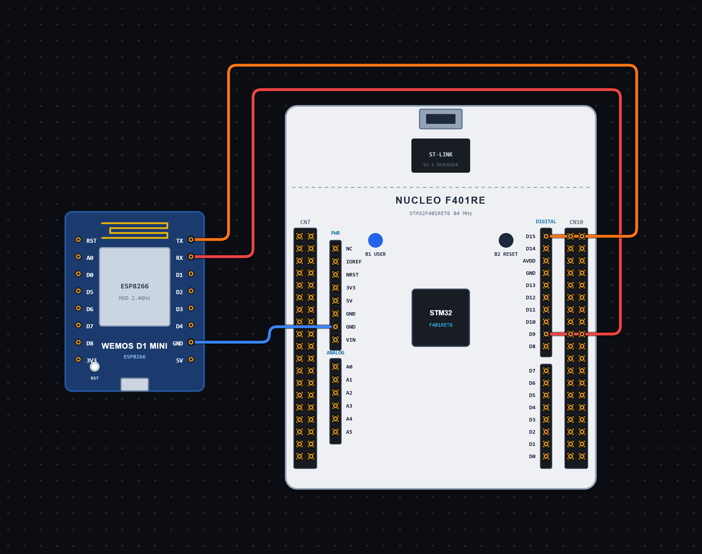

# EXPERIMENT DETAILS

**EXP:** CONTINUOUS ASSESSMENT 11

**DATE:** 11/10/2026

**NAME OF EXP:** HTTP Server Configuration using ESP Module and STM32

**HARDWARE SETUP / PLATFORM:** STM32 Microcontroller + ESP Module + STM32CubeIDE / HAL Library

---

## TASK 11A : Configuring an HTTP Server using ESP AT Commands

### 1. Circuit Diagram

The experiment demonstrates configuring an HTTP server on the ESP module using AT commands sent from the STM32 microcontroller through UART communication.

- **Microcontroller:** STM32
- **Communication Peripheral:** USART6
- **Communication Module:** ESP Module
- **Communication Mode:** UART Transmit and Receive
- **Baud Rate:** 115200
- **Word Length:** 8 Bits
- **Stop Bits:** 1
- **Parity:** None
- **Hardware Flow Control:** Disabled
- **Server Port:** 80
- **Programming Environment:** STM32CubeIDE

**Circuit Diagram:**

### 2. Core Logic / Pseudocode / Code Base

**Working Principle:**

The experiment uses USART6 to communicate with the ESP module and configure it as an HTTP server.

After initializing the STM32 peripherals, the program sends a sequence of AT commands to configure the server.

First, the `AT` command checks communication with the ESP module. The `AT+CIPSERVER=0` command disables any previously running server.

The `AT+CIPMUX=1` command enables multiple connection mode, which allows the ESP module to handle multiple TCP connections.

Next, the `AT+CIPSERVER=1,80` command starts the TCP server on port 80. Finally, the `AT+CIFSR` command retrieves the IP address of the ESP module.

Once the server is configured, a client can connect to the ESP module using its IP address and port 80.

**AT Commands Used:**

| AT Command | Purpose |
| ----------------------------------- | -------------------------------- |
| `AT` | Checks communication with the ESP module |
| `AT+CIPSERVER=0` | Disables an existing server |
| `AT+CIPMUX=1` | Enables multiple connection mode |
| `AT+CIPSERVER=1,80` | Starts the server on port 80 |
| `AT+CIFSR` | Retrieves the IP address of the ESP module |

**Pseudocode:**

1. Initialize the HAL library using `HAL_Init()`.
2. Configure the system clock using `SystemClock_Config()`.
3. Initialize GPIO and USART6 peripherals.
4. Create a receive buffer to store responses from the ESP module.
5. Send the `AT` command to check communication.
6. Wait for 1000 milliseconds.
7. Send the `AT+CIPSERVER=0` command to disable an existing server.
8. Wait for 1000 milliseconds.
9. Send the `AT+CIPMUX=1` command to enable multiple connection mode.
10. Wait for 1000 milliseconds.
11. Send the `AT+CIPSERVER=1,80` command to start the server on port 80.
12. Wait for 1000 milliseconds.
13. Send the `AT+CIFSR` command to retrieve the ESP module's IP address.
14. Wait for 1000 milliseconds.
15. Enter an infinite loop.

**Code Base:**

The program is written in Embedded C using the STM32 HAL library.

- `main.h` provides the required STM32 definitions and HAL declarations.
- `stdio.h` provides standard input/output function declarations.
- `string.h` provides string-handling functions.
- `stdlib.h` provides standard utility functions.
- `UART_HandleTypeDef huart6` defines the UART handle for USART6.
- `HAL_Init()` initializes the HAL library and system tick.
- `SystemClock_Config()` configures the system clock using an external high-speed clock source and PLL.
- `MX_GPIO_Init()` enables the required GPIO port clocks.
- `MX_USART6_UART_Init()` configures USART6 for serial communication.
- `HAL_UART_Transmit()` sends AT commands to the ESP module.
- `HAL_Delay()` provides a 1000-millisecond delay between consecutive commands.
- `rx[512]` is declared as a buffer for receiving data from the ESP module.
- `rxLen` stores the received data length.
- `cmd1[]` stores the basic `AT` command.
- `cmd2[]` stores the command to disable an existing server.
- `cmd3[]` stores the command to enable multiple connection mode.
- `cmd4[]` stores the command to start the server on port 80.
- `cmd5[]` stores the command to retrieve the IP address.

### 3. Inference

The experiment demonstrates configuring an ESP module as a TCP server using AT commands through the STM32 microcontroller.

The ESP module is configured for multiple connections, and a server is started on port 80. Its IP address can then be retrieved to allow a client to connect to the server.

The experiment provides an understanding of UART communication, ESP AT commands, TCP server configuration, multiple connection mode and basic HTTP server setup using Embedded C programming.