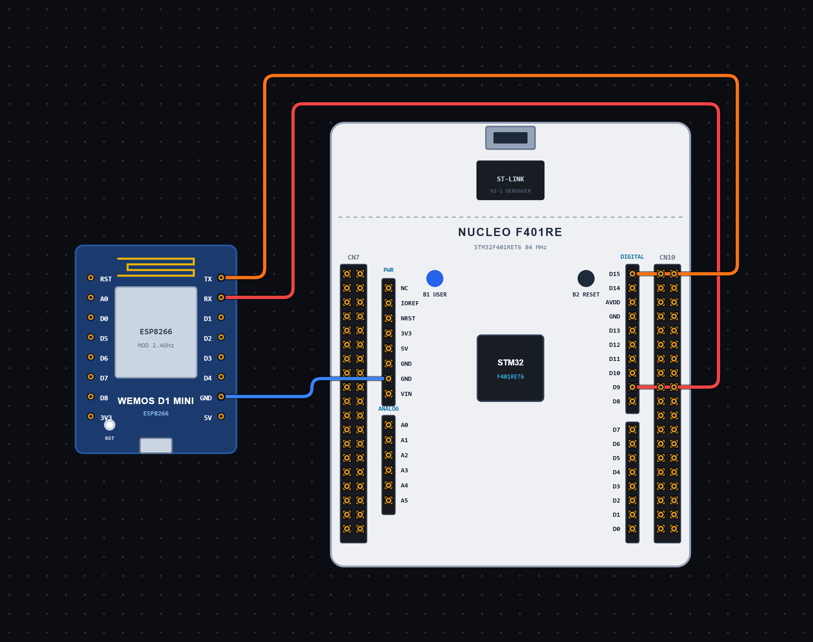

# EXPERIMENT DETAILS

**EXP:** CONTINUOUS ASSESSMENT 11

**DATE:** 11/10/2026

**NAME OF EXP:** HTTP Webpage Hosting using ESP Module and STM32

**HARDWARE SETUP / PLATFORM:** STM32 Microcontroller + ESP Module + Node-RED + STM32CubeIDE / HAL Library

---

## TASK 11B : Hosting an HTML Webpage using ESP Module and Accessing it through Node-RED

### 1. Circuit Diagram

The experiment demonstrates hosting a simple HTML webpage using an ESP module configured as a TCP server. The STM32 microcontroller communicates with the ESP module through UART and handles incoming client requests. Node-RED is used as a second HTTP client to access the hosted webpage and display the received response.

- **Microcontroller:** STM32
- **Communication Peripheral:** USART6
- **Communication Module:** ESP Module
- **Communication Mode:** UART Transmit and Receive
- **Baud Rate:** 115200
- **Word Length:** 8 Bits
- **Stop Bits:** 1
- **Parity:** None
- **Hardware Flow Control:** Disabled
- **Server Port:** 80
- **Webpage Content:** HTML
- **Additional Platform:** Node-RED
- **Node-RED Communication:** HTTP Request
- **Programming Environment:** STM32CubeIDE

**Circuit Diagram:**

### 2. Core Logic / Pseudocode / Code Base

**Working Principle:**

The experiment uses the STM32 microcontroller and ESP module to host a simple HTML webpage that can be accessed through a web browser or Node-RED.

Initially, the STM32 sends AT commands through USART6 to configure the ESP module as a TCP server.

The `AT` command checks communication with the ESP module. The `AT+CIPSERVER=0` command disables an existing server, while `AT+CIPMUX=1` enables multiple connection mode. The `AT+CIPSERVER=1,80` command starts the server on port 80.

The `AT+CIFSR` command retrieves the IP address of the ESP module.

After server configuration, the program continuously checks for incoming data using `HAL_UARTEx_ReceiveToIdle()`. When a client connects, the received data is checked for the `+IPD,` notification.

The connection ID is extracted using `atoi()`. The program then prepares a simple HTML webpage containing the heading **STM32 IoT Node** and the message **Hello from STM32**.

An HTTP response is created with the status code `200 OK`, content type `text/html` and the content length.

The `AT+CIPSEND` command is used to specify the connection ID and number of bytes to be transmitted. After receiving the `>` prompt from the ESP module, the HTTP response is transmitted.

Finally, the connection is closed using the `AT+CIPCLOSE` command.

**Node-RED HTTP Communication:**

Node-RED is used as a second HTTP client to communicate with the STM32/ESP module HTTP server.

The Node-RED flow consists of three nodes:

1. **Inject Node:** Triggers the HTTP request.
2. **HTTP Request Node:** Sends an HTTP request to the ESP module using the URL `http://<ESP8266_IP>/`.
3. **Debug Node:** Displays the HTTP response received from the STM32.

When the Inject node is triggered, the HTTP Request node sends a request to the ESP module's IP address. The ESP module forwards the request to the STM32 through UART.

The STM32 processes the request and sends an HTTP 200 OK response containing the HTML webpage. Node-RED receives this response and displays it in the Debug window.

**Node-RED Flow:**

`Inject Node → HTTP Request Node → Debug Node`

**AT Commands Used:**

| AT Command | Purpose |
|---|---|
| `AT` | Checks communication with the ESP module |
| `AT+CIPSERVER=0` | Disables an existing server |
| `AT+CIPMUX=1` | Enables multiple connection mode |
| `AT+CIPSERVER=1,80` | Starts the TCP server on port 80 |
| `AT+CIFSR` | Retrieves the IP address of the ESP module |
| `AT+CIPSEND=id,length` | Specifies the connection ID and data length for transmission |
| `AT+CIPCLOSE=id` | Closes the specified client connection |

**Pseudocode:**

1. Initialize the HAL library using `HAL_Init()`.
2. Configure the system clock using `SystemClock_Config()`.
3. Initialize GPIO and USART6 peripherals.
4. Create a receive buffer and initialize the received data length.
5. Send the `AT` command to check communication.
6. Send the `AT+CIPSERVER=0` command to disable an existing server.
7. Send the `AT+CIPMUX=1` command to enable multiple connection mode.
8. Send the `AT+CIPSERVER=1,80` command to start the server on port 80.
9. Send the `AT+CIFSR` command to retrieve the ESP module's IP address.
10. Enter an infinite loop.
11. Clear the receive buffer and reset the received data length.
12. Receive incoming UART data using `HAL_UARTEx_ReceiveToIdle()`.
13. Check whether data has been received.
14. Search for the `+IPD,` notification using `strstr()`.
15. If the notification is found:
    - Extract the client connection ID using `atoi()`.
    - Prepare the HTML webpage content.
    - Create an HTTP response containing the webpage and response headers.
16. Send the `AT+CIPSEND` command with the connection ID and response length.
17. Wait for the ESP module to return the `>` prompt.
18. If the prompt is received:
    - Transmit the HTTP response through USART6.
    - Wait for the transmission response.
    - Send the `AT+CIPCLOSE` command to close the client connection.
19. Configure the Node-RED flow using Inject, HTTP Request and Debug nodes.
20. Set the HTTP Request node URL to `http://<ESP8266_IP>/`.
21. Trigger the Inject node to send an HTTP request.
22. Receive the HTTP response from the STM32/ESP module in the Debug node.
23. Repeat continuously to handle incoming client requests.

**Code Base:**

The program is written in Embedded C using the STM32 HAL library.

- `main.h` provides the required STM32 definitions and HAL declarations.
- `stdio.h` provides standard input/output functions such as `snprintf()`.
- `string.h` provides string-handling functions such as `strlen()`, `memset()`, `strstr()` and `strchr()`.
- `stdlib.h` provides utility functions such as `atoi()`.
- `UART_HandleTypeDef huart6` defines the UART handle for USART6.
- `HAL_Init()` initializes the HAL library and system tick.
- `SystemClock_Config()` configures the system clock.
- `MX_GPIO_Init()` enables the required GPIO port clocks.
- `MX_USART6_UART_Init()` configures USART6 for serial communication.
- `HAL_UART_Transmit()` sends AT commands and HTTP response data to the ESP module.
- `HAL_UARTEx_ReceiveToIdle()` receives incoming UART data until the UART becomes idle or the specified timeout occurs.
- `HAL_Delay()` provides delays between server configuration commands.
- `rx[512]` stores incoming data from the ESP module.
- `rxLen` stores the number of bytes received.
- `strstr()` searches for the `+IPD,` notification in the received data.
- `atoi()` extracts the client connection ID from the received notification.
- `body[]` stores the HTML webpage content.
- `response[256]` stores the complete HTTP response, including headers and HTML content.
- `snprintf()` formats the HTTP response and generates the `AT+CIPSEND` command.
- `strlen()` calculates the length of the HTTP response and command strings.
- `strchr()` checks whether the ESP module has returned the `>` prompt.
- `AT+CIPSEND` is used to send the webpage data to the connected client.
- `AT+CIPCLOSE` closes the client connection after sending the response.

**Node-RED Nodes Used:**

- **Inject Node:** Triggers the HTTP request.
- **HTTP Request Node:** Sends an HTTP request to the ESP module's IP address.
- **Debug Node:** Displays the HTTP response received from the STM32/ESP module.

### 3. Inference

The experiment demonstrates hosting and serving a simple HTML webpage using an ESP module controlled by an STM32 microcontroller.

The ESP module is configured as a TCP server on port 80. When a client accesses the server through a web browser or Node-RED, the STM32 detects the incoming connection, prepares an HTTP response and sends the HTML webpage to the client.

Node-RED acts as a second HTTP client by sending requests to the ESP module and displaying the received HTTP response through the Debug node.

The experiment provides an understanding of UART communication, TCP server configuration, client connection handling, HTTP response formatting, HTML webpage transmission, Node-RED HTTP communication and embedded web server implementation using STM32 and ESP AT commands.