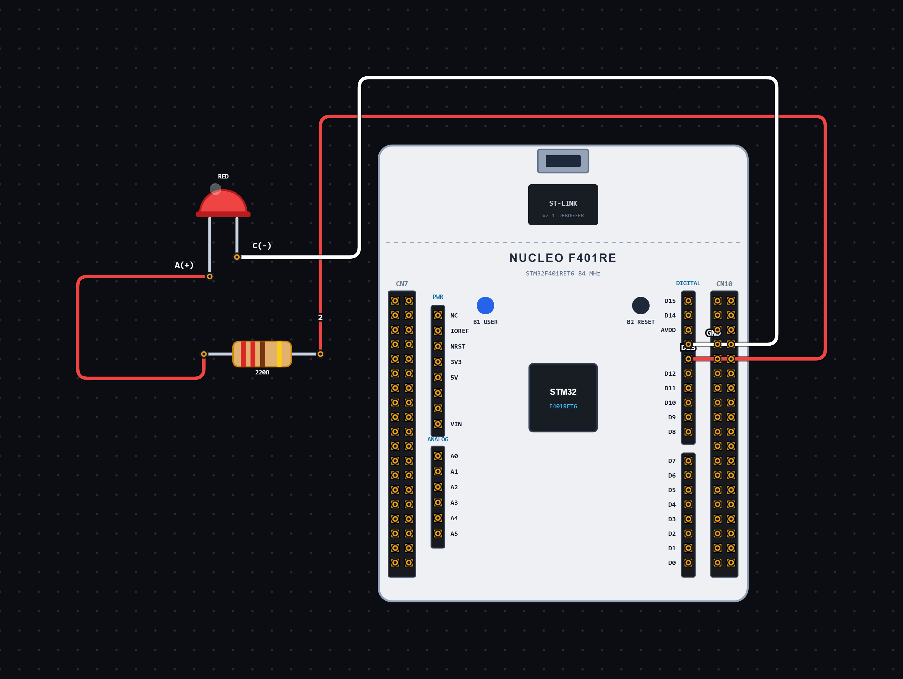

# EXPERIMENT DETAILS

**EXP:** CONTINUOUS ASSESSMENT 12

**DATE:** 16/10/2026

**NAME OF EXP:** LED Blinking using STM32 GPIO

**HARDWARE SETUP / PLATFORM:** STM32 Microcontroller + STM32CubeIDE / HAL Library

---

## TASK 12A : Blinking LED using STM32

### 1. Circuit Diagram

The experiment demonstrates blinking an LED connected to the STM32 microcontroller using GPIO output control.

- **Microcontroller:** STM32
- **Output Device:** LED
- **Output GPIO Pin:** PA5
- **GPIO Mode:** Output Push-Pull
- **Pull Configuration:** Pull-up
- **Output Speed:** Low
- **Programming Environment:** STM32CubeIDE

**Circuit Diagram:**

### 2. Core Logic / Pseudocode / Code Base

**Working Principle:**

The experiment uses GPIO output control to blink an LED connected to PA5 of the STM32 microcontroller.

After initializing the HAL library, system clock and GPIO peripherals, the program continuously changes the output state of PA5.

The LED is first turned OFF by setting PA5 to `GPIO_PIN_RESET`. A delay of 500 milliseconds is provided. Then, PA5 is set to `GPIO_PIN_SET` to turn the LED ON, followed by another 500-millisecond delay.

This process repeats continuously, producing a blinking effect with equal ON and OFF intervals.

**Operating Conditions:**

| Operation | LED Behaviour |
| ----------------------------------- | -------------------------------- |
| GPIO Output RESET | LED OFF |
| GPIO Output SET | LED ON |
| Delay | 500 milliseconds |
| Blinking Cycle | 500 ms ON + 500 ms OFF |

**Pseudocode:**

1. Initialize the HAL library using `HAL_Init()`.
2. Configure the system clock using `SystemClock_Config()`.
3. Initialize GPIO peripherals using `MX_GPIO_Init()`.
4. Configure PA5 as GPIO Output Push-Pull.
5. Enter an infinite loop.
6. Set PA5 to `GPIO_PIN_RESET` to turn OFF the LED.
7. Wait for 500 milliseconds using `HAL_Delay()`.
8. Set PA5 to `GPIO_PIN_SET` to turn ON the LED.
9. Wait for another 500 milliseconds.
10. Repeat continuously.

**Code Base:**

The program is written in Embedded C using the STM32 HAL library.

- `main.h` provides the required STM32 definitions and HAL declarations.
- `HAL_Init()` initializes the HAL library and system tick.
- `SystemClock_Config()` configures the system clock using an external high-speed clock source and PLL.
- `MX_GPIO_Init()` initializes the GPIO peripherals.
- `__HAL_RCC_GPIOA_CLK_ENABLE()` enables the GPIOA peripheral clock.
- `HAL_GPIO_WritePin()` sets the output state of the LED connected to PA5.
- `HAL_Delay()` provides a delay of 500 milliseconds between LED state changes.
- `GPIO_PIN_5` identifies PA5 as the output pin.
- `GPIO_MODE_OUTPUT_PP` configures PA5 in Output Push-Pull mode.
- `GPIO_PULLUP` enables the internal pull-up configuration.
- `GPIO_SPEED_FREQ_LOW` configures the GPIO output speed as low.

### 3. Inference

The experiment demonstrates LED blinking using GPIO output control on the STM32 microcontroller.

The LED connected to PA5 continuously turns ON and OFF with a delay of 500 milliseconds between each state change.

The experiment provides an understanding of GPIO configuration, output control, HAL delay functions and basic Embedded C programming using the STM32 HAL library.