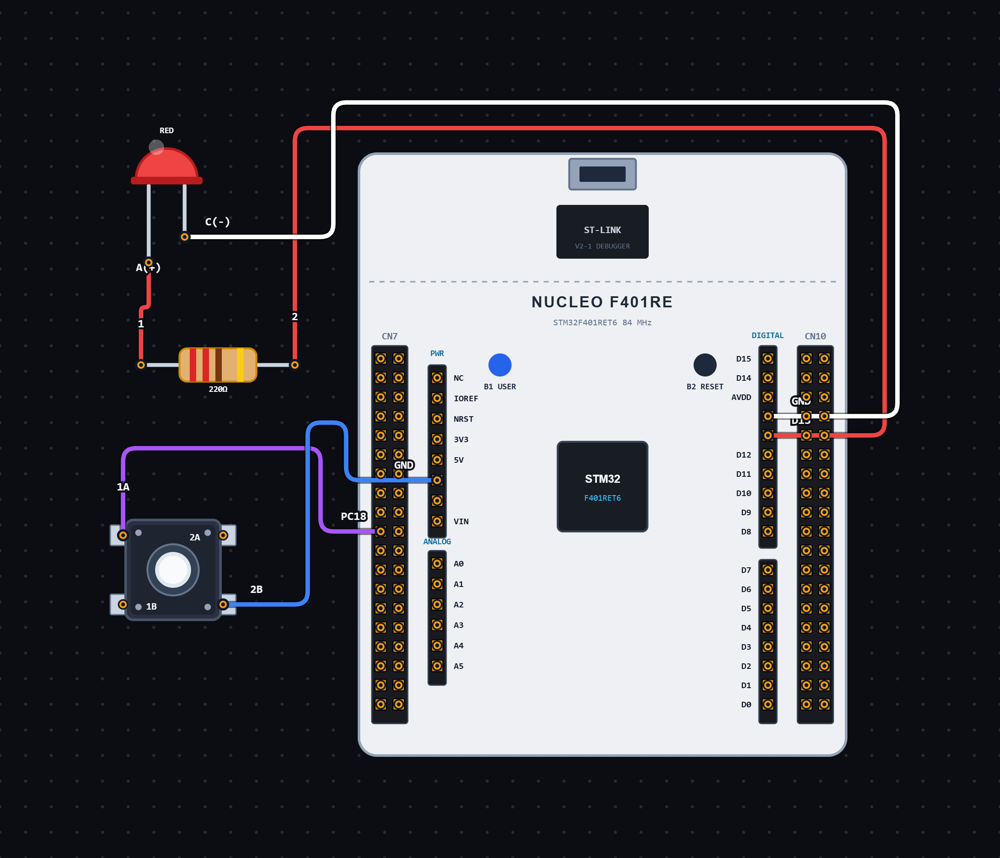

# EXPERIMENT DETAILS

**EXP:** CONTINUOUS ASSESSMENT 12

**DATE:** 16/10/2026

**NAME OF EXP:** Push Button Controlled LED using STM32

**HARDWARE SETUP / PLATFORM:** STM32 Microcontroller + STM32CubeIDE / HAL Library

---

## TASK 12B : Push Button Controlled LED Operation using STM32

### 1. Circuit Diagram

The experiment demonstrates controlling an LED using a push button connected to the STM32 microcontroller.

- **Microcontroller:** STM32
- **Input Device:** Push Button
- **Input GPIO Pin:** PC13
- **Output Device:** LED
- **Output GPIO Pin:** PA5
- **Input Configuration:** GPIO Input, No Pull-up / Pull-down
- **Output Configuration:** GPIO Output Push-Pull
- **Output Pull Configuration:** Pull-up
- **Output Speed:** Low
- **Programming Environment:** STM32CubeIDE

**Circuit Diagram:**

### 2. Core Logic / Pseudocode / Code Base

**Working Principle:**

The experiment uses a push button connected to PC13 to control an LED connected to PA5 of the STM32 microcontroller.

Initially, the LED is turned OFF by setting PA5 to `GPIO_PIN_SET`.

The program continuously checks the push button state using `HAL_GPIO_ReadPin()`. When the button is pressed, the program waits for 30 milliseconds and checks the button state again to avoid unwanted triggering due to mechanical bouncing.

If the button is still pressed, the `led_state` variable is toggled.

- If `led_state` becomes 1, PA5 is set to `GPIO_PIN_RESET`, turning ON the LED.
- If `led_state` becomes 0, PA5 is set to `GPIO_PIN_SET`, turning OFF the LED.

The program then waits until the button is released and applies another 30-millisecond delay before checking for the next press.

**Operating Conditions:**

| Button Operation | LED Behaviour |
| ----------------------------------- | -------------------------------- |
| Initial Condition | LED OFF |
| First Valid Button Press | LED ON |
| Second Valid Button Press | LED OFF |
| Every Subsequent Press | Toggles the LED state |

**Pseudocode:**

1. Initialize the HAL library using `HAL_Init()`.
2. Configure the system clock using `SystemClock_Config()`.
3. Initialize GPIO peripherals using `MX_GPIO_Init()`.
4. Configure PC13 as GPIO input and PA5 as GPIO output.
5. Initialize `led_state` to 0.
6. Set PA5 to `GPIO_PIN_SET` to turn OFF the LED.
7. Enter an infinite loop.
8. Read the push button state from PC13.
9. If the button is pressed:
   - Wait for 30 milliseconds.
   - Read the button state again.
10. If the button is still pressed:
    - Toggle the `led_state` variable.
    - If `led_state` is 1, set PA5 to RESET to turn ON the LED.
    - Otherwise, set PA5 to SET to turn OFF the LED.
11. Wait until the button is released.
12. Wait for another 30 milliseconds to debounce the button.
13. Repeat continuously.

**Code Base:**

The program is written in Embedded C using the STM32 HAL library.

- `main.h` provides the required STM32 definitions and HAL declarations.
- `HAL_Init()` initializes the HAL library and system tick.
- `SystemClock_Config()` configures the system clock using an external high-speed clock source and PLL.
- `MX_GPIO_Init()` initializes the GPIO peripherals.
- `__HAL_RCC_GPIOC_CLK_ENABLE()` enables the GPIOC peripheral clock.
- `__HAL_RCC_GPIOA_CLK_ENABLE()` enables the GPIOA peripheral clock.
- `HAL_GPIO_ReadPin()` reads the push button state from PC13.
- `HAL_GPIO_WritePin()` controls the LED connected to PA5.
- `HAL_Delay()` provides the 30-millisecond debounce delay.
- `GPIO_PIN_13` identifies PC13 as the button input pin.
- `GPIO_PIN_5` identifies PA5 as the LED output pin.
- `GPIO_MODE_INPUT` configures PC13 as an input.
- `GPIO_MODE_OUTPUT_PP` configures PA5 as Output Push-Pull.
- `GPIO_NOPULL` configures PC13 without an internal pull-up or pull-down resistor.
- `GPIO_PULLUP` enables the internal pull-up configuration for PA5.
- `led_state` stores the logical state of the LED.
- A 30-millisecond debounce interval is used to reduce unwanted button-triggered changes.

### 3. Inference

The experiment demonstrates push-button-based LED control using GPIO input and output operations on the STM32 microcontroller.

Each valid button press changes the LED state. The LED alternates between ON and OFF with every successive press.

The experiment provides an understanding of GPIO input handling, output control, button debouncing, state management and LED interfacing using STM32 HAL functions and Embedded C programming.