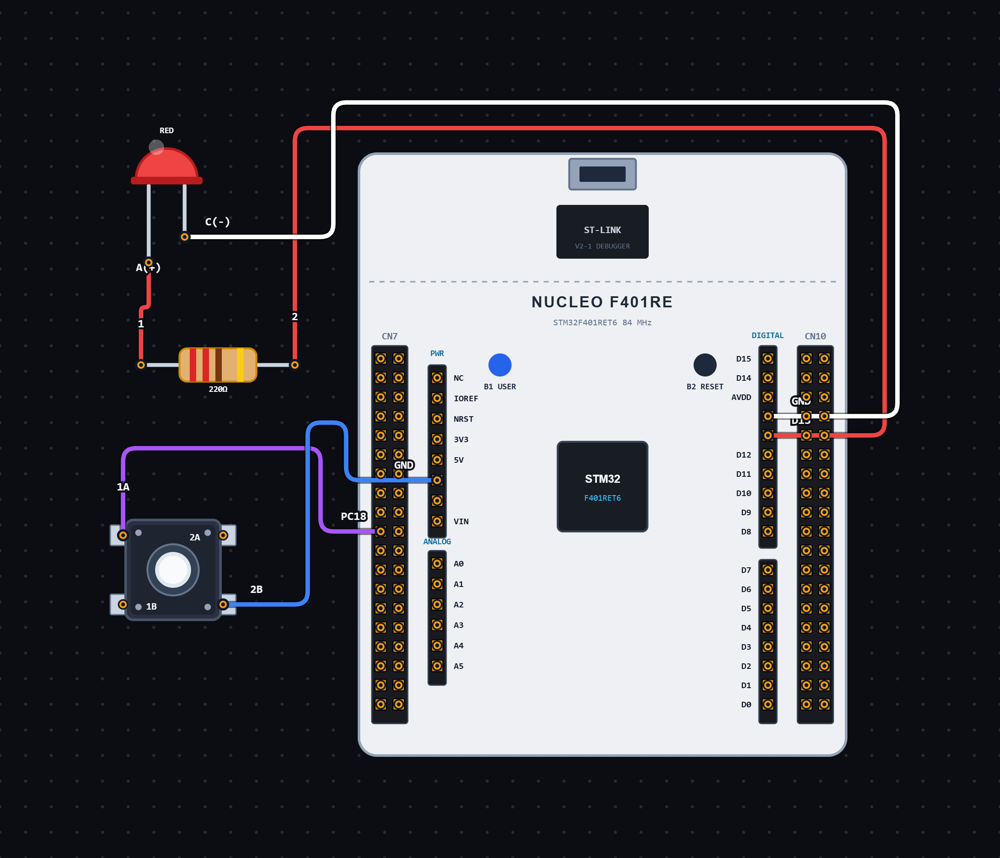

# EXPERIMENT DETAILS

**EXP:** CONTINUOUS ASSESSMENT 12

**DATE:** 16/10/2026

**NAME OF EXP:** Short and Long Press Based LED Control using STM32

**HARDWARE SETUP / PLATFORM:** STM32 Microcontroller + STM32CubeIDE / HAL Library

---

## TASK 12C : Short and Long Press Controlled LED Operation using STM32

### 1. Circuit Diagram

The experiment demonstrates controlling an LED using short and long button presses with the STM32 microcontroller.

- **Microcontroller:** STM32
- **Input Device:** On-board Push Button B1
- **Input GPIO Pin:** PC13
- **Output Device:** On-board LED LD2
- **Output GPIO Pin:** PA5
- **Input Configuration:** GPIO Input, Pull-down
- **Output Configuration:** GPIO Output Push-Pull
- **Output Pull Configuration:** No Pull-up / Pull-down
- **Output Speed:** Low
- **Programming Environment:** STM32CubeIDE

**Circuit Diagram:**

### 2. Core Logic / Pseudocode / Code Base

**Working Principle:**

The experiment uses the on-board push button connected to PC13 to control the LED connected to PA5 of the STM32 microcontroller.

The program detects short and long button presses using the `HAL_GetTick()` function, which measures time in milliseconds.

When the button is pressed, the program records the press start time. If the button is released before one second, the LED changes its state once.

If the button remains pressed for one second or longer, the program identifies it as a long press. The LED then starts blinking continuously with a 250-millisecond interval while the button is held.

When the button is released after a long press, the blinking stops and the LED is turned OFF.

The program uses non-blocking time checks instead of blocking delays for detecting button duration and controlling LED blinking.

**Operating Conditions:**

| Button Operation | LED Behaviour |
| ----------------------------------- | -------------------------------- |
| Initial Condition | LED OFF |
| Short Press (Less than 1 second) | Toggles LED state |
| Long Press (1 second or longer) | LED blinks while button is held |
| Button Release after Long Press | Stops blinking and turns LED OFF |

**Pseudocode:**

1. Initialize the HAL library using `HAL_Init()`.
2. Configure the system clock using `SystemClock_Config()`.
3. Initialize GPIO peripherals using `MX_GPIO_Init()`.
4. Configure PA5 as GPIO output and PC13 as GPIO input.
5. Initialize the button and LED state variables.
6. Turn OFF the LED initially.
7. Enter an infinite loop.
8. Read the push button state from PC13.
9. If the button is pressed:
   - Check whether it is a new press.
   - Set `button_pressed` to 1.
   - Record the press start time using `HAL_GetTick()`.
   - Reset the `long_press` flag.
10. Check whether the button has been held for at least 1000 milliseconds.
11. If the long-press condition is reached:
    - Set `long_press` to 1.
    - Check whether 250 milliseconds have elapsed since the previous LED toggle.
    - Toggle the LED using `HAL_GPIO_TogglePin()`.
    - Update the blinking time.
12. If the button is released:
    - Check whether a button press was previously detected.
    - If it was a short press, toggle the LED.
    - Reset the `button_pressed` variable.
13. If long-press mode was active:
    - Turn OFF the LED.
    - Reset the `long_press` flag.
14. Repeat continuously.

**Code Base:**

The program is written in Embedded C using the STM32 HAL library.

- `main.h` provides the required STM32 definitions and HAL declarations.
- `LONG_PRESS_TIME` defines the long-press threshold as 1000 milliseconds.
- `BLINK_INTERVAL` defines the LED blinking interval as 250 milliseconds.
- `HAL_Init()` initializes the HAL library and system tick.
- `SystemClock_Config()` configures the system clock using an external high-speed clock source and PLL.
- `MX_GPIO_Init()` initializes the GPIO peripherals.
- `HAL_GPIO_ReadPin()` reads the push button state from PC13.
- `HAL_GPIO_WritePin()` controls the LED connected to PA5.
- `HAL_GPIO_TogglePin()` changes the LED output state.
- `HAL_GetTick()` returns the current system tick in milliseconds.
- `press_start_time` stores the time when the button is first pressed.
- `blink_time` stores the time of the previous LED toggle.
- `button_pressed` indicates whether the button is currently being held.
- `long_press` indicates whether the long-press condition has been reached.
- `led_state` stores the logical LED state variable.
- `GPIO_PIN_13` identifies PC13 as the button input pin.
- `GPIO_PIN_5` identifies PA5 as the LED output pin.
- `GPIO_MODE_INPUT` configures PC13 as an input.
- `GPIO_MODE_OUTPUT_PP` configures PA5 as Output Push-Pull.
- `GPIO_PULLDOWN` enables the internal pull-down configuration for PC13.
- `GPIO_NOPULL` configures PA5 without an internal pull-up or pull-down resistor.

### 3. Inference

The experiment demonstrates short-press and long-press detection using GPIO input and time-based control on the STM32 microcontroller.

A short button press toggles the LED state, while holding the button for one second or longer makes the LED blink continuously at 250-millisecond intervals. Releasing the button after a long press stops the blinking and turns OFF the LED.

The experiment provides an understanding of GPIO input handling, button press duration detection, time measurement using HAL tick functions, state management and non-blocking LED control using Embedded C programming.