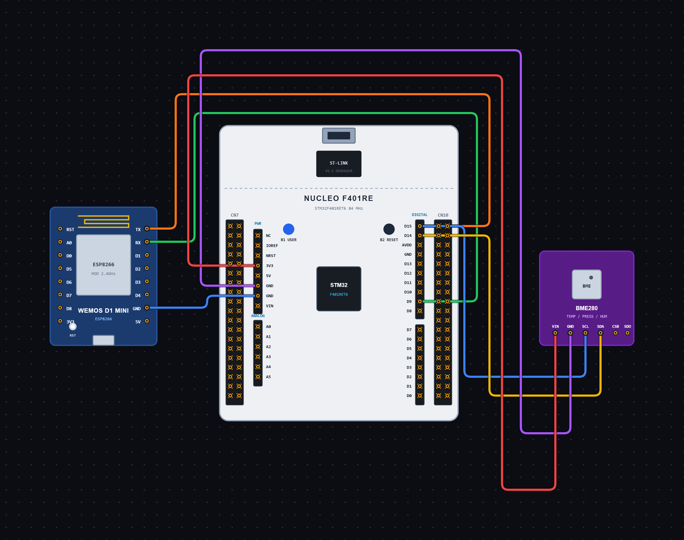

# EXPERIMENT DETAILS

**EXP:** CONTINUOUS ASSESSMENT 13

**DATE:** 23/10/2026

**NAME OF EXP:** Interfacing BME280 Sensor with STM32 and Displaying Sensor Readings through UART

**HARDWARE SETUP / PLATFORM:** STM32 Microcontroller, BME280 Sensor

---

## TASK 13 : BME280 SENSOR INTERFACING USING I2C AND UART

### 1. Circuit Diagram

The BME280 sensor is connected to the STM32 microcontroller using the I2C communication protocol. The sensor readings are transmitted through UART and displayed on a serial terminal.

- **Microcontroller:** STM32
- **Input Device:** BME280 Temperature, Pressure and Humidity Sensor
- **Communication Interface (Sensor):** I2C1
- **Communication Interface (Output):** USART6
- **I2C Configuration:** 100 kHz, 7-bit addressing
- **UART Configuration:** 115200 baud rate, 8 data bits, no parity, 1 stop bit
- **Programming Environment:** STM32CubeIDE / STM32 HAL Library

**Circuit Diagram:**

### 2. Core Logic / Pseudocode / Code Base

**Working Principle:**

The BME280 sensor measures temperature, atmospheric pressure and humidity. The STM32 communicates with the sensor through the I2C1 interface.

The sensor is initialized using the BME280 driver library. The oversampling settings are configured to 1X for temperature, pressure and humidity. The filter is disabled, and the standby time is set to 1000 ms.

After initialization, the sensor is placed in normal mode. The STM32 continuously reads all three sensor parameters, converts pressure from Pa to hPa and formats the readings to two decimal places.

The readings are then transmitted through USART6 every one second and displayed on a serial terminal.

**Operating Conditions:**

| Parameter | Configuration |
|---|---|
| Temperature Oversampling | 1X |
| Pressure Oversampling | 1X |
| Humidity Oversampling | 1X |
| Filter | Disabled |
| Standby Time | 1000 ms |
| I2C Clock Speed | 100 kHz |
| UART Baud Rate | 115200 |
| Data Transmission Interval | 1 second |

**Pseudocode:**

1. Initialize the STM32 HAL library.
2. Configure the system clock.
3. Initialize GPIO, I2C1 and USART6 peripherals.
4. Configure the BME280 device structure with I2C read, write and delay functions.
5. Initialize the BME280 sensor.
6. Check whether sensor initialization is successful.
7. Configure temperature, pressure and humidity oversampling settings.
8. Set the sensor to normal operating mode.
9. Repeat continuously:
   - Read temperature, pressure and humidity from the BME280 sensor.
   - Convert pressure from Pa to hPa.
   - Format the sensor readings to two decimal places.
   - Transmit the readings through USART6.
   - If sensor reading fails, transmit an error message.
   - Wait for 1 second.

**Code Base:**

- **`main.h`:** Contains the main header file and STM32 HAL definitions.
- **`bme280.h`:** Contains BME280 sensor definitions, structures and function declarations.
- **`bme280.c`:** Contains the BME280 driver functions for sensor initialization, register communication, data reading and compensation.
- **`struct bme280_dev dev`:** Stores the sensor configuration and communication interface details.
- **`struct bme280_data comp_data`:** Stores the compensated temperature, pressure and humidity readings.
- **`user_i2c_read()`:** Reads data from the BME280 registers using `HAL_I2C_Mem_Read()`.
- **`user_i2c_write()`:** Writes data to the BME280 registers using `HAL_I2C_Mem_Write()`.
- **`user_delay_us()`:** Provides the delay required by the BME280 driver.
- **`bme280_init()`:** Initializes the sensor and checks its chip ID.
- **`bme280_set_sensor_settings()`:** Configures oversampling, filter and standby settings.
- **`bme280_set_sensor_mode()`:** Sets the sensor to normal operating mode.
- **`bme280_get_sensor_data()`:** Reads the temperature, pressure and humidity values.
- **`snprintf()`:** Formats the sensor readings into a readable string with two decimal places.
- **`HAL_UART_Transmit()`:** Transmits the formatted sensor data through USART6.
- **`HAL_Delay(1000)`:** Creates a one-second delay between consecutive readings.

### 3. Inference

The experiment demonstrates interfacing a BME280 environmental sensor with an STM32 microcontroller using the I2C communication protocol. Temperature, pressure and humidity readings are successfully obtained using the sensor driver library and transmitted through USART6 for display on a serial terminal. This experiment helps understand I2C communication, sensor configuration, data acquisition and UART-based serial communication.