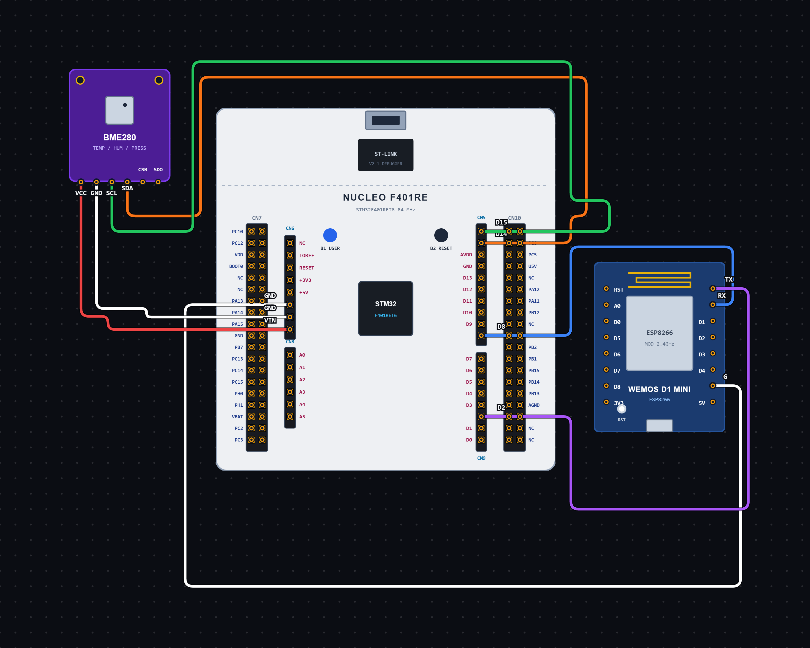

# EXPERIMENT DETAILS

**EXP:** CONTINUOUS ASSESSMENT 14

**DATE:** 29/10/2026

**NAME OF EXP:** Interfacing BME280 Sensor with STM32 and Publishing Sensor Data Using MQTT

**HARDWARE SETUP / PLATFORM:** STM32 Microcontroller, BME280 Sensor, ESP8266 Wi-Fi Module, Node-RED

---

## TASK 14 : BME280 SENSOR DATA TRANSMISSION USING ESP8266, MQTT AND NODE-RED

### 1. Circuit Diagram

The BME280 sensor is connected to the STM32 microcontroller through the I2C1 interface. The ESP8266 Wi-Fi module is connected through USART1 and is used to connect to a Wi-Fi network and publish sensor readings to an MQTT broker. Node-RED subscribes to the MQTT topic and receives the sensor readings for monitoring and visualization.

- **Microcontroller:** STM32
- **Input Device:** BME280 Temperature, Pressure and Humidity Sensor
- **Wi-Fi Module:** ESP8266
- **Sensor Communication:** I2C1
- **ESP8266 Communication:** USART1
- **BME280 I2C Address:** 0x76
- **I2C Clock Speed:** 100 kHz
- **UART Configuration:** 115200 baud rate, 8 data bits, no parity, 1 stop bit
- **MQTT Broker:** broker.emqx.io
- **MQTT Port:** 1883
- **MQTT Topic:** /bavana
- **Data Visualization Platform:** Node-RED
- **Node-RED Communication:** MQTT Subscription
- **Programming Environment:** STM32CubeIDE / STM32 HAL Library

**Circuit Diagram:**



### 2. Core Logic / Pseudocode / Code Base

**Working Principle:**

The BME280 sensor measures temperature, atmospheric pressure and humidity. The STM32 communicates with the sensor using the I2C1 interface and obtains the readings using the Bosch BME280 driver library.

The ESP8266 Wi-Fi module is connected to the STM32 through USART1. The STM32 communicates with the ESP8266 using AT commands.

Initially, the BME280 sensor is initialized and configured with 1X oversampling for temperature, pressure and humidity. The sensor is then set to normal operating mode.

Next, the ESP8266 is reset and configured to station mode. It connects to the specified Wi-Fi network and establishes a TCP connection with the MQTT broker at broker.emqx.io on port 1883.

After establishing the connection, the STM32 sends an MQTT CONNECT packet to the broker. The sensor readings are continuously collected and formatted into JSON data containing temperature, humidity and pressure values.

The JSON payload is published to the MQTT topic `/bavana` using an MQTT PUBLISH packet with QoS 0. The process repeats every one second, allowing the latest sensor readings to be transmitted to the MQTT broker.

**Node-RED MQTT Communication:**

Node-RED is used to receive and monitor the BME280 sensor readings published by the STM32 through the MQTT broker.

The Node-RED flow is configured to connect to the same MQTT broker, `broker.emqx.io`, using port `1883`.

The MQTT In node subscribes to the topic `/bavana` and receives the JSON payload published by the STM32. The received data is processed and its temperature, humidity and pressure values can be displayed using Node-RED Debug or dashboard nodes.

This allows the sensor readings to be monitored in real time through the Node-RED interface.

**Node-RED Flow:**

`MQTT In Node → JSON Node → Debug / Dashboard Nodes`

**Operating Conditions:**

| Parameter | Configuration |
|---|---|
| BME280 Oversampling | 1X for all parameters |
| Filter | Disabled |
| Standby Time | 1000 ms |
| I2C Clock Speed | 100 kHz |
| UART Baud Rate | 115200 |
| Wi-Fi Mode | Station Mode |
| TCP Connection | broker.emqx.io |
| MQTT Port | 1883 |
| MQTT Version | MQTT 3.1.1 |
| MQTT QoS | 0 |
| MQTT Topic | /bavana |
| Data Publishing Interval | 1 second |
| Node-RED Subscription | /bavana |

**Pseudocode:**

1. Initialize the STM32 HAL library and configure the system clock.
2. Initialize GPIO, I2C1 and USART1 peripherals.
3. Configure the BME280 communication interface.
4. Initialize the BME280 sensor and check its status.
5. Configure temperature, pressure and humidity oversampling settings.
6. Set the BME280 sensor to normal operating mode.
7. Reset the ESP8266 module using the AT reset command.
8. Disable command echo using `ATE0`.
9. Configure the ESP8266 in station mode using `AT+CWMODE=1`.
10. Connect the ESP8266 to the Wi-Fi network using `AT+CWJAP`.
11. Configure single TCP connection mode using `AT+CIPMUX=0`.
12. Establish a TCP connection with the MQTT broker.
13. Send the MQTT CONNECT packet to establish the MQTT session.
14. Repeat continuously:
    - Read temperature, pressure and humidity from the BME280 sensor.
    - Convert the readings into suitable decimal values.
    - Format the readings into a JSON payload.
    - Create an MQTT PUBLISH packet with QoS 0.
    - Send the packet through the ESP8266 using `AT+CIPSEND`.
    - Wait for the transmission confirmation.
    - Wait for one second before the next reading.
15. Configure the Node-RED MQTT broker connection using `broker.emqx.io` and port `1883`.
16. Add an MQTT In node and subscribe to the topic `/bavana`.
17. Receive the JSON sensor payload from the MQTT broker.
18. Process the received payload using a JSON node.
19. Display the temperature, humidity and pressure values using Debug or dashboard nodes.

**Code Base:**

- **`main.c`:** Contains the main program, peripheral initialization, sensor configuration, Wi-Fi connection and MQTT publishing logic.
- **`main.h`:** Contains the main header file and STM32 HAL definitions.
- **`bme280.h`:** Contains the BME280 sensor structures, register definitions and function declarations.
- **`bme280.c`:** Contains the Bosch BME280 driver functions for sensor initialization, register communication, calibration and measurement compensation.
- **`ESPLib.c`:** Contains ESP8266 communication functions and MQTT-related helper functions.
- **`I2C_HandleTypeDef hi2c1`:** Handles I2C1 communication with the BME280 sensor.
- **`UART_HandleTypeDef huart1`:** Handles USART1 communication with the ESP8266 module.
- **`BME_Read()`:** Reads sensor registers using `HAL_I2C_Mem_Read()`.
- **`BME_Write()`:** Writes data to sensor registers using `HAL_I2C_Mem_Write()`.
- **`bme280_init()`:** Initializes the BME280 sensor and checks its chip ID.
- **`bme280_set_sensor_settings()`:** Configures the sensor oversampling, filter and standby settings.
- **`bme280_set_sensor_mode()`:** Sets the sensor to normal operating mode.
- **`bme280_get_sensor_data()`:** Reads and compensates the temperature, pressure and humidity measurements.
- **`ESP_DrainRx()`:** Clears previously received ESP8266 responses.
- **`ESP_WaitFor()`:** Waits for an expected response from the ESP8266 within a specified timeout.
- **`ESP_SendAT()`:** Sends AT commands to the ESP8266 and checks its response.
- **`ESP_SendMqttPacket()`:** Sends MQTT packets through the ESP8266 TCP connection using `AT+CIPSEND`.
- **`MQTT_PublishJson()`:** Constructs an MQTT PUBLISH packet containing the topic and JSON payload.
- **`mqttJson`:** Stores the formatted sensor readings in JSON format.
- **`snprintf()`:** Formats temperature, pressure and humidity values into a JSON string.
- **`HAL_UART_Transmit()`:** Transmits AT commands and MQTT packet data through USART1.
- **`HAL_UART_Receive()`:** Receives responses from the ESP8266.
- **`HAL_Delay(1000)`:** Provides a one-second delay between successive sensor readings and MQTT publications.
- **`debug_stage`:** Tracks the current execution stage to help identify where the program stops during debugging.

**Node-RED Nodes Used:**

- **MQTT In Node:** Connects to the MQTT broker and subscribes to the `/bavana` topic.
- **JSON Node:** Converts the received JSON payload into an object so that individual sensor values can be accessed.
- **Debug Node:** Displays the received sensor data in the Node-RED Debug panel.
- **Dashboard Nodes:** Can be connected to display temperature, humidity and pressure readings on the Node-RED dashboard.

**Example JSON Payload:**

```json
{
  "status": "success",
  "temperature": 29.25,
  "humidity": 74.47,
  "pressure": 1014.56
}
```

### 3. Inference

The experiment demonstrates the integration of environmental sensing, Wi-Fi communication and MQTT-based data transmission using an STM32 microcontroller.

The BME280 sensor readings are collected through I2C communication, formatted into JSON data and transmitted through the ESP8266 Wi-Fi module to an MQTT broker.

Node-RED subscribes to the same MQTT topic and receives the published sensor readings. The received temperature, humidity and pressure values can then be displayed on the Node-RED interface for real-time monitoring.

The experiment helps understand sensor interfacing, UART communication, ESP8266 AT commands, TCP connections, MQTT publishing and subscribing, JSON data handling and IoT dashboard integration.