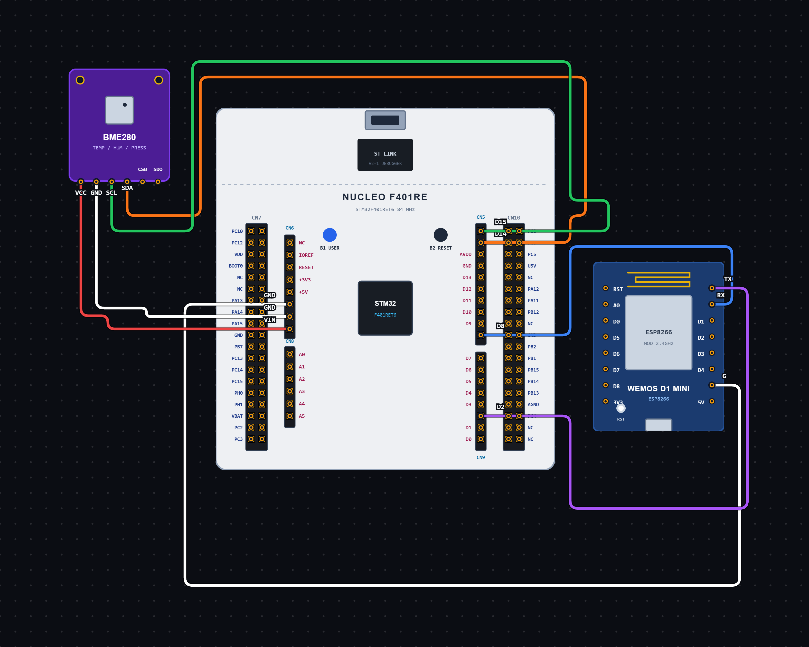
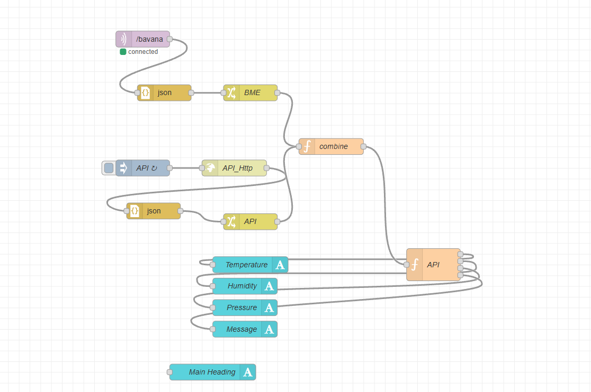

# EXPERIMENT DETAILS

**EXP:** CONTINUOUS ASSESSMENT 15

**DATE:** 12/11/2026

**NAME OF EXP:** Project-Complete IoT Flow

**HARDWARE SETUP / PLATFORM:** STM32 Microcontroller, BME280 Sensor, ESP8266 Wi-Fi Module, MQTT Broker, Node-RED

---

## TASK 15 : COMPLETE IoT SYSTEM FOR SENSOR MONITORING AND WEATHER-BASED DRYING RECOMMENDATION

### 1. Circuit Diagram

The mini-project demonstrates an IoT-based environmental monitoring and weather comparison system using an STM32 microcontroller, BME280 sensor and ESP8266 Wi-Fi module.

The BME280 sensor is connected to the STM32 through the I2C1 interface to measure temperature, atmospheric pressure and humidity. The ESP8266 communicates with the STM32 through USART1 and connects to a Wi-Fi network.

The STM32 collects the sensor readings, converts them into JSON format and publishes them to an MQTT broker. Node-RED receives the sensor data through MQTT and combines it with weather forecast information. The received data is processed to compare local sensor readings with forecast values and generate a weather-based clothes-drying recommendation.

- **Microcontroller:** STM32
- **Input Device:** BME280 Temperature, Pressure and Humidity Sensor
- **Wi-Fi Module:** ESP8266
- **Sensor Communication:** I2C1
- **ESP8266 Communication:** USART1
- **BME280 I2C Address:** 0x76
- **I2C Clock Speed:** 100 kHz
- **UART Configuration:** 115200 baud rate, 8 data bits, no parity, 1 stop bit
- **MQTT Broker:** broker.emqx.io
- **MQTT Port:** 1883
- **MQTT Topic:** /bavana
- **Data Processing Platform:** Node-RED
- **Weather Data Source:** Weather API
- **Data Format:** JSON
- **Programming Environment:** STM32CubeIDE / STM32 HAL Library / Node-RED

**Circuit Diagram:**



### 2. Core Logic / Pseudocode / Code Base

**Working Principle:**

The project combines environmental sensing, wireless communication, MQTT data transmission and weather-based data processing.

**1. BME280 Sensor Interfacing:**

The BME280 sensor measures temperature, atmospheric pressure and humidity. The STM32 communicates with the sensor using the I2C1 interface and obtains the readings using the Bosch BME280 driver library.

The sensor is configured with 1X oversampling for temperature, pressure and humidity. The filter is disabled, the standby time is configured to 1000 ms, and the sensor is operated in normal mode.

**2. ESP8266 Wi-Fi Communication:**

The ESP8266 Wi-Fi module is connected to the STM32 through USART1. The STM32 communicates with the module using AT commands.

Initially, the ESP8266 is reset and configured in station mode. It connects to the available Wi-Fi network and establishes a TCP connection with the MQTT broker at `broker.emqx.io` using port `1883`.

**3. MQTT Data Transmission:**

After establishing the TCP connection, the STM32 sends an MQTT CONNECT packet to establish an MQTT session with the broker.

The BME280 sensor readings are continuously collected and formatted into a JSON payload containing temperature, humidity and pressure values.

The JSON payload is published to the MQTT topic `/bavana` using an MQTT PUBLISH packet with QoS 0.

The sensor readings are published once every second, allowing Node-RED to receive updated local environmental data.

**4. Node-RED Data Collection and Weather Comparison:**

Node-RED subscribes to the MQTT topic `/bavana` and receives the sensor readings published by the STM32.

The Node-RED flow also obtains weather forecast information through a Weather API. The sensor data and forecast data are combined into a single message and passed to a Function node for processing.

The Function node extracts the following parameters:

- Local temperature, humidity and pressure from the BME280 sensor.
- Forecast temperature, humidity and pressure from the Weather API.
- Rain probability and expected rainfall from the forecast data.
- General weather condition, such as rain or thunderstorm.

The local sensor readings are compared with the forecast values to understand the difference between current environmental conditions and forecast conditions.

**5. Weather-Based Clothes Drying Recommendation:**

The processed data is used to generate a clothes-drying recommendation based on local humidity and forecast rain conditions.

The local BME280 humidity reading is given priority, while the weather forecast is used to identify expected rainfall.

The recommendation is generated using the following conditions:

| Condition | Recommendation |
|---|---|
| Rain probability ≥ 30%, rainfall ≥ 1 mm or thunderstorm forecast | DRY INDOORS |
| Local humidity > 70% | DRY INDOORS |
| Local humidity between 60% and 70% | MODERATE |
| Local humidity below 60%, with no significant rain risk | DRY OUTSIDE |

If rain is expected, the system recommends indoor drying regardless of the local humidity reading.

**6. Node-RED Dashboard:**

The processed results are sent to the Node-RED dashboard for monitoring and visualization.

The system provides four main outputs:

1. **Temperature Comparison:** Displays the BME280 temperature and weather forecast temperature.
2. **Humidity Comparison:** Displays the BME280 humidity and weather forecast humidity.
3. **Pressure Comparison:** Displays the BME280 atmospheric pressure and weather forecast pressure.
4. **Drying Recommendation:** Displays whether clothes should be dried indoors, outdoors or under moderate conditions, along with an explanation.

This allows the user to monitor environmental conditions and receive a suitable clothes-drying recommendation through the Node-RED interface.


**Node-RED Interfacing:**



**Overall IoT Flow:**

`BME280 → STM32 → ESP8266 → MQTT Broker → Node-RED`

`Weather API → Node-RED`

`Sensor Data + Weather Data → Function Node → Dashboard`

**Operating Conditions:**

| Parameter | Configuration |
|---|---|
| BME280 Oversampling | 1X for all parameters |
| Filter | Disabled |
| Standby Time | 1000 ms |
| I2C Clock Speed | 100 kHz |
| UART Baud Rate | 115200 |
| Wi-Fi Mode | Station Mode |
| MQTT Broker | broker.emqx.io |
| MQTT Port | 1883 |
| MQTT Version | MQTT 3.1.1 |
| MQTT QoS | 0 |
| MQTT Topic | /bavana |
| Sensor Publishing Interval | 1 second |
| Node-RED Processing | Function Node |
| Output Parameters | Temperature, Humidity, Pressure and Recommendation |

**Pseudocode:**

**STM32 and BME280:**

1. Initialize the STM32 HAL library and configure the system clock.
2. Initialize GPIO, I2C1 and USART1 peripherals.
3. Configure the BME280 communication interface.
4. Initialize the BME280 sensor and check its status.
5. Configure temperature, pressure and humidity oversampling settings.
6. Set the BME280 sensor to normal operating mode.
7. Reset the ESP8266 module using the AT reset command.
8. Disable command echo using `ATE0`.
9. Configure the ESP8266 in station mode using `AT+CWMODE=1`.
10. Connect the ESP8266 to the Wi-Fi network using `AT+CWJAP`.
11. Configure single TCP connection mode using `AT+CIPMUX=0`.
12. Establish a TCP connection with the MQTT broker.
13. Send the MQTT CONNECT packet to establish the MQTT session.
14. Repeat continuously:
    - Read temperature, pressure and humidity from the BME280 sensor.
    - Convert the readings into suitable decimal values.
    - Format the readings into a JSON payload.
    - Create an MQTT PUBLISH packet with QoS 0.
    - Send the packet through the ESP8266 using `AT+CIPSEND`.
    - Wait for the transmission confirmation.
    - Wait for one second before the next reading.

**Node-RED Data Processing:**

15. Connect Node-RED to the MQTT broker using `broker.emqx.io` and port `1883`.
16. Subscribe to the MQTT topic `/bavana` to receive BME280 sensor data.
17. Obtain weather forecast information through the Weather API.
18. Combine the BME280 sensor data and weather forecast data into a single message.
19. Pass the combined data to the Function node.
20. Check whether the BME280 sensor status is successful.
21. Extract local temperature, humidity and pressure readings.
22. Extract forecast temperature, humidity and pressure readings.
23. Extract rain probability, rainfall amount and general weather condition.
24. Compare the local sensor readings with the weather forecast values.
25. Generate temperature, humidity and pressure comparison messages.
26. Check the rain probability, rainfall amount and weather condition.
27. Generate a clothes-drying recommendation:
    - If significant rain is expected, recommend indoor drying.
    - If local humidity is above 70%, recommend indoor drying.
    - If local humidity is between 60% and 70%, display a moderate recommendation.
    - If local humidity is below 60% and rain risk is minimal, recommend outdoor drying.
28. Send the four outputs to the Node-RED dashboard.
29. Display the sensor comparisons and drying recommendation.

**Code Base:**

**STM32 Firmware:**

- **`main.c`:** Contains the main program, peripheral initialization, BME280 sensor configuration, Wi-Fi connection and MQTT publishing logic.
- **`main.h`:** Contains the main header file and STM32 HAL definitions.
- **`bme280.h`:** Contains the BME280 sensor structures, register definitions and function declarations.
- **`bme280.c`:** Contains the Bosch BME280 driver functions for sensor initialization, register communication, calibration and measurement compensation.
- **`ESPLib.c`:** Contains ESP8266 communication functions and MQTT-related helper functions.
- **`I2C_HandleTypeDef hi2c1`:** Handles I2C1 communication with the BME280 sensor.
- **`UART_HandleTypeDef huart1`:** Handles USART1 communication with the ESP8266 module.
- **`BME_Read()`:** Reads sensor registers using `HAL_I2C_Mem_Read()`.
- **`BME_Write()`:** Writes data to sensor registers using `HAL_I2C_Mem_Write()`.
- **`bme280_init()`:** Initializes the BME280 sensor and checks its chip ID.
- **`bme280_set_sensor_settings()`:** Configures the sensor oversampling, filter and standby settings.
- **`bme280_set_sensor_mode()`:** Sets the sensor to normal operating mode.
- **`bme280_get_sensor_data()`:** Reads and compensates the temperature, pressure and humidity measurements.
- **`ESP_DrainRx()`:** Clears previously received ESP8266 responses.
- **`ESP_WaitFor()`:** Waits for an expected response from the ESP8266 within a specified timeout.
- **`ESP_SendAT()`:** Sends AT commands to the ESP8266 and checks its response.
- **`ESP_SendMqttPacket()`:** Sends MQTT packets through the ESP8266 TCP connection using `AT+CIPSEND`.
- **`MQTT_PublishJson()`:** Constructs an MQTT PUBLISH packet containing the topic and JSON payload.
- **`mqttJson`:** Stores the formatted sensor readings in JSON format.
- **`snprintf()`:** Formats temperature, pressure and humidity values into a JSON string.
- **`HAL_UART_Transmit()`:** Transmits AT commands and MQTT packet data through USART1.
- **`HAL_UART_Receive()`:** Receives responses from the ESP8266.
- **`HAL_Delay(1000)`:** Provides a one-second delay between successive sensor readings and MQTT publications.
- **`debug_stage`:** Tracks the current execution stage to help identify where the program stops during debugging.

**Node-RED Processing:**

- **MQTT In Node:** Connects to the MQTT broker and subscribes to the `/bavana` topic to receive sensor readings.
- **Weather API Node:** Retrieves weather forecast information.
- **Combine Function Node:** Combines the BME280 sensor data and weather forecast data into a single message.
- **Processing Function Node:** Extracts the required values, compares local sensor readings with forecast values and generates the drying recommendation.
- **Temperature Output:** Displays the local and forecast temperature comparison.
- **Humidity Output:** Displays the local and forecast humidity comparison.
- **Pressure Output:** Displays the local and forecast pressure comparison.
- **Recommendation Output:** Displays the final clothes-drying recommendation and explanation.
- **Dashboard Nodes:** Display the processed environmental data and recommendation through the Node-RED dashboard.

**Example BME280 JSON Payload:**

```json
{
  "status": "success",
  "temperature": 29.25,
  "humidity": 74.47,
  "pressure": 1014.56
}
```

**Example Processing Output:**

```text
Temperature:
BME: 29.3 °C | Forecast: 30.0 °C

Humidity:
BME: 74.5 % | Forecast: 70.0 %

Pressure:
BME: 1014.6 hPa | Forecast: 1012.0 hPa

Recommendation:
DRY INDOORS — Local humidity is high and may slow down drying.
```

### 3. Inference

The mini-project demonstrates the integration of environmental sensing, Wi-Fi communication, MQTT data transmission and weather-based data processing using an STM32 microcontroller.

The BME280 sensor collects local temperature, pressure and humidity readings through I2C communication. These readings are transmitted through the ESP8266 Wi-Fi module to an MQTT broker in JSON format.

Node-RED receives the sensor data through MQTT and combines it with weather forecast information obtained through a Weather API. The processing function compares the local sensor readings with the forecast values and evaluates rainfall conditions to generate a clothes-drying recommendation.

The final results are displayed through the Node-RED dashboard, providing temperature, humidity and pressure comparisons along with recommendations to dry clothes indoors, outdoors or under moderate conditions.

The project provides practical understanding of sensor interfacing, UART communication, ESP8266 AT commands, MQTT communication, JSON data handling, API integration, Node-RED processing and IoT dashboard development.