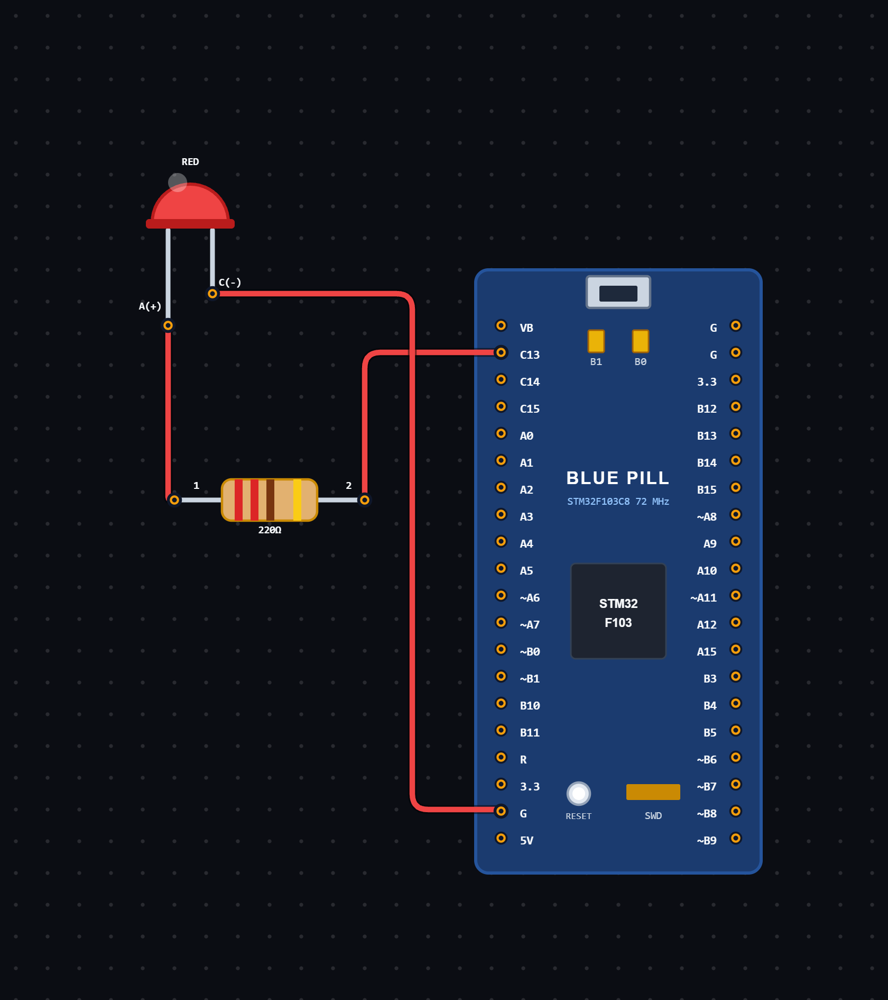

# EXPERIMENT DETAILS

**EXP:** CONTINUOUS ASSESSMENT 8

**DATE:** 24/09/2026

**NAME OF EXP:** On-board LED Blinking Using STM32

**HARDWARE SETUP / PLATFORM:** STM32 Microcontroller + STM32CubeIDE / HAL Library

---

## TASK 8A : On-board LED Blinking

### 1. Circuit Diagram

The experiment demonstrates blinking an LED connected to GPIO pin PC13 of the STM32 microcontroller using the HAL library.

- **Microcontroller:** STM32
- **GPIO Port:** GPIOC
- **GPIO Pin:** PC13
- **Peripheral:** On-board LED
- **GPIO Mode:** Output Push-Pull
- **Pull Configuration:** No Pull-up / Pull-down
- **LED ON/OFF Control:** GPIO Output
- **Programming Environment:** STM32CubeIDE

**Circuit Diagram:**

### 2. Core Logic / Pseudocode / Code Base

**Working Principle:**

The experiment uses the STM32 HAL library to control an LED connected to GPIO pin PC13.

Initially, the HAL library is initialized using `HAL_Init()`. The system clock is configured, and GPIO peripherals are initialized.

Pin PC13 is configured as a general-purpose output pin in push-pull mode.

Inside the infinite loop, the GPIO pin is first set to LOW using `HAL_GPIO_WritePin()`. A delay of 500 milliseconds is introduced using `HAL_Delay()`.

The pin is then set to HIGH, followed by another 500-millisecond delay.

This process repeats continuously, producing an LED blinking effect.

**Pseudocode:**

1. Initialize the HAL library using `HAL_Init()`.
2. Configure the system clock.
3. Enable the GPIOC peripheral clock.
4. Configure PC13 as an output push-pull pin.
5. Set the initial output state of PC13 to LOW.
6. Enter an infinite loop.
7. Set PC13 to LOW.
8. Wait for 500 milliseconds.
9. Set PC13 to HIGH.
10. Wait for 500 milliseconds.
11. Repeat continuously.

**Code Base:**

The program is written in Embedded C using the STM32 HAL library.

- `main.h` contains the required STM32 definitions and HAL declarations.
- `HAL_Init()` initializes the HAL library and system tick.
- `SystemClock_Config()` configures the system clock using the external high-speed oscillator and PLL.
- `MX_GPIO_Init()` initializes the GPIO peripherals.
- `__HAL_RCC_GPIOC_CLK_ENABLE()` enables the GPIOC peripheral clock.
- `GPIO_PIN_13` selects pin PC13.
- `GPIO_MODE_OUTPUT_PP` configures PC13 as an output push-pull pin.
- `GPIO_NOPULL` disables internal pull-up and pull-down resistors.
- `HAL_GPIO_WritePin()` sets the output state of PC13.
- `HAL_Delay(500)` generates a delay of 500 milliseconds.

### 3. Inference

The experiment demonstrates basic GPIO output control using the STM32 HAL library.

The LED connected to PC13 continuously switches between LOW and HIGH states with a delay of 500 milliseconds between transitions.

The experiment provides an understanding of STM32 initialization, system clock configuration, GPIO configuration and output control using HAL functions.