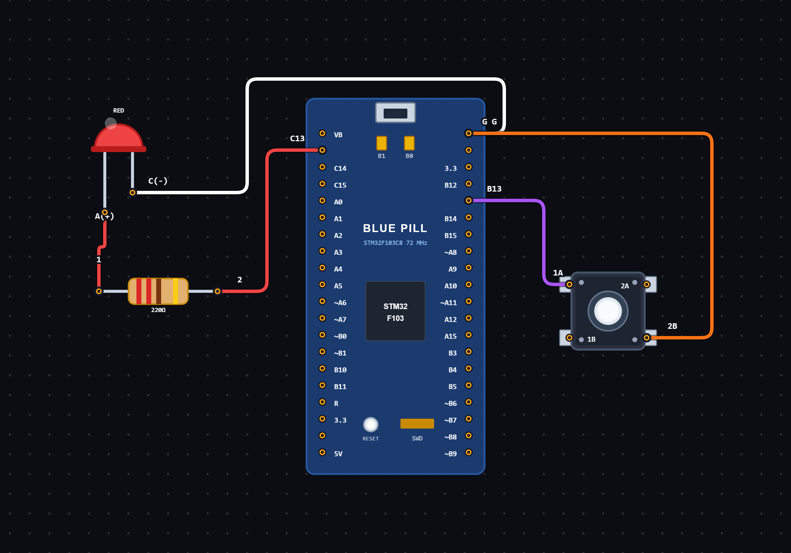

# EXPERIMENT DETAILS

**EXP:** CONTINUOUS ASSESSMENT 8

**DATE:** 24/09/2026

**NAME OF EXP:** Push Button Controlled LED Using STM32

**HARDWARE SETUP / PLATFORM:** STM32 Microcontroller + STM32CubeIDE / HAL Library

---

## TASK 8B : Push Button Controlled LED

### 1. Circuit Diagram

The experiment demonstrates controlling an LED using a push button connected to the STM32 microcontroller.

- **Microcontroller:** STM32
- **Input Device:** Push Button
- **Input GPIO Pin:** PB13
- **Output Device:** On-board LED
- **Output GPIO Pin:** PC13
- **Input Configuration:** GPIO Input, No Pull-up / Pull-down
- **Output Configuration:** GPIO Output Push-Pull
- **Programming Environment:** STM32CubeIDE

**Circuit Diagram:**

### 2. Core Logic / Pseudocode / Code Base

**Working Principle:**

The experiment uses a push button connected to GPIO pin PB13 to control an LED connected to GPIO pin PC13.

Initially, the HAL library and system clock are initialized, followed by GPIO configuration.

Pin PB13 is configured as an input pin, while PC13 is configured as an output push-pull pin.

Inside the infinite loop, the program continuously reads the input state of PB13 using `HAL_GPIO_ReadPin()`.

If PB13 is LOW, the LED output PC13 is set to LOW. Otherwise, PC13 is set to HIGH.

This allows the push button input to control the LED output continuously.

**Pseudocode:**

1. Initialize the HAL library using `HAL_Init()`.
2. Configure the system clock.
3. Enable the GPIOB and GPIOC peripheral clocks.
4. Configure PB13 as an input pin.
5. Configure PC13 as an output push-pull pin.
6. Enter an infinite loop.
7. Read the input state of PB13.
8. If PB13 is LOW:
   - Set PC13 to LOW.
9. Otherwise:
   - Set PC13 to HIGH.
10. Repeat continuously to monitor the push button and control the LED.

**Code Base:**

The program is written in Embedded C using the STM32 HAL library.

- `main.h` provides the required STM32 definitions and HAL declarations.
- `HAL_Init()` initializes the HAL library and system tick.
- `SystemClock_Config()` configures the system clock.
- `MX_GPIO_Init()` initializes the GPIO peripherals.
- `__HAL_RCC_GPIOB_CLK_ENABLE()` enables the GPIOB peripheral clock.
- `__HAL_RCC_GPIOC_CLK_ENABLE()` enables the GPIOC peripheral clock.
- `GPIO_PIN_13` selects pin PB13 for button input and PC13 for LED output.
- `GPIO_MODE_INPUT` configures PB13 as an input pin.
- `GPIO_MODE_OUTPUT_PP` configures PC13 as an output push-pull pin.
- `HAL_GPIO_ReadPin()` reads the current state of PB13.
- `HAL_GPIO_WritePin()` controls the output state of PC13.
- `GPIO_PIN_RESET` represents the LOW state.
- `GPIO_PIN_SET` represents the HIGH state.

### 3. Inference

The experiment demonstrates push-button-based LED control using GPIO input and output operations on the STM32 microcontroller.

The push button connected to PB13 controls the LED connected to PC13 based on its input state.

The experiment provides an understanding of GPIO configuration, digital input reading, output control and STM32 HAL library functions.