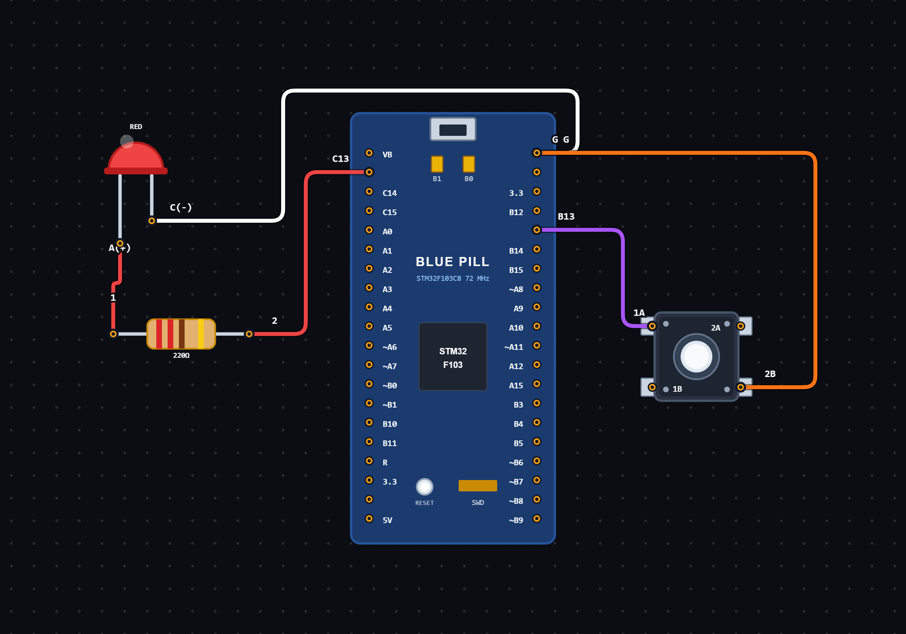

# EXPERIMENT DETAILS

**EXP:** CONTINUOUS ASSESSMENT 8

**DATE:** 24/09/2026

**NAME OF EXP:** Short and Long Press Based LED Control Using STM32

**HARDWARE SETUP / PLATFORM:** STM32 Microcontroller + STM32CubeIDE / HAL Library

---

## TASK 8C : Short and Long Press Controlled LED Operation

### 1. Circuit Diagram

The experiment demonstrates controlling an LED using short and long button presses with the STM32 microcontroller.

- **Microcontroller:** STM32
- **Input Device:** Push Button
- **Input GPIO Pin:** PB13
- **Output Device:** On-board LED
- **Output GPIO Pin:** PC13
- **Input Configuration:** GPIO Input, No Pull-up / Pull-down
- **Output Configuration:** GPIO Output Push-Pull
- **Programming Environment:** STM32CubeIDE

**Circuit Diagram:**

### 2. Core Logic / Pseudocode / Code Base

**Working Principle:**

The experiment uses a push button connected to PB13 to control an LED connected to PC13.

The program identifies short and long button presses using the STM32 HAL tick counter.

A debounce mechanism is implemented using a 20-millisecond delay check to avoid unwanted changes caused by mechanical button bouncing.

If the button is pressed and released before one second, the LED changes its state once.

If the button remains pressed for one second or longer, the program enters blink mode. The LED starts blinking continuously with a 500-millisecond interval.

The program uses non-blocking time checks with `HAL_GetTick()` to manage button timing and LED blinking without using blocking delays.

**Operating Conditions:**

| Button Operation | LED Behaviour |
|---|---|
| Short Press | Toggles LED state |
| Long Press (1 second) | Starts continuous blinking |
| Short Press after blink mode starts | Stops blinking and turns LED OFF |

**Pseudocode:**

1. Initialize the HAL library using `HAL_Init()`.
2. Configure the system clock and GPIO pins.
3. Initialize the timing and button state variables.
4. Enter an infinite loop.
5. Read the current system tick using `HAL_GetTick()`.
6. Read the push button state from PB13.
7. Detect changes in the button input and update the candidate time.
8. Check whether the input has remained stable for 20 milliseconds.
9. If a valid button press is detected:
   - Record the press start time.
   - Reset the long press detection flag.
10. If the button is released before one second:
    - If blink mode is active, stop blinking and turn OFF the LED.
    - Otherwise, toggle the LED state.
11. If the button remains pressed for one second:
    - Enable blink mode.
    - Mark the long press as handled.
    - Turn ON the LED.
    - Record the blinking start time.
12. If blink mode is active:
    - Check whether 500 milliseconds have elapsed.
    - Toggle the LED.
    - Update the last blink time.
13. Repeat continuously.

**Code Base:**

The program is written in Embedded C using the STM32 HAL library.

- `main.h` provides the required STM32 definitions and HAL declarations.
- `HAL_Init()` initializes the HAL library and system tick.
- `SystemClock_Config()` configures the system clock.
- `MX_GPIO_Init()` initializes the GPIO peripherals.
- `HAL_GetTick()` returns the current system tick in milliseconds.
- `HAL_GPIO_ReadPin()` reads the push button state from PB13.
- `HAL_GPIO_WritePin()` controls the LED connected to PC13.
- `pressStart` stores the time when the button is pressed.
- `candidateTime` stores the time of the latest detected button input change.
- `lastButtonReading` stores the previous raw button reading.
- `buttonState` stores the debounced button state.
- `longPressHandled` prevents a long press from being processed repeatedly.
- `blinkMode` indicates whether continuous LED blinking is active.
- `lastBlink` stores the time of the previous LED toggle.
- `ledState` stores the current logical LED state.
- `LED_On()` turns ON the LED using active-LOW logic.
- `LED_Off()` turns OFF the LED using active-LOW logic.
- `LED_Toggle()` changes the current LED state.
- A 20-millisecond debounce interval is used to filter button bouncing.
- A 1000-millisecond threshold is used to identify a long press.
- A 500-millisecond interval controls continuous LED blinking.

### 3. Inference

The experiment demonstrates short press and long press detection using GPIO input and time-based control on the STM32 microcontroller.

A short button press toggles the LED state, while a long press activates continuous LED blinking. Another short press stops the blinking operation.

The experiment provides an understanding of GPIO input handling, button debouncing, time measurement using HAL tick functions, state management and non-blocking LED control using Embedded C programming.