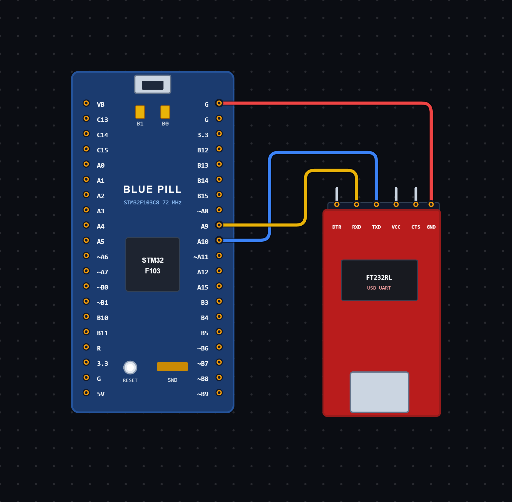

# EXPERIMENT DETAILS

**EXP:** CONTINUOUS ASSESSMENT 9

**DATE:** 01/10/2026

**NAME OF EXP:** UART Data Transmission and Reception using STM32

**HARDWARE SETUP / PLATFORM:** STM32 Microcontroller + STM32CubeIDE / HAL Library

---

## TASK 9A : UART Data Transmission and Reception using STM32

### 1. Circuit Diagram

The experiment demonstrates UART data transmission and reception using the USART1 peripheral of the STM32 microcontroller.

- **Microcontroller:** STM32
- **Communication Peripheral:** USART1
- **Communication Mode:** Transmit and Receive
- **Baud Rate:** 115200
- **Word Length:** 8 Bits
- **Stop Bits:** 1
- **Parity:** None
- **Hardware Flow Control:** Disabled
- **Programming Environment:** STM32CubeIDE

**Circuit Diagram:**

### 2. Core Logic / Pseudocode / Code Base

**Working Principle:**

The experiment uses the USART1 peripheral of the STM32 microcontroller for serial communication.

The STM32 continuously transmits the character `T` followed by a new line at one-second intervals.

At the same time, the program checks for incoming UART data using the `HAL_UARTEx_ReceiveToIdle()` function.

When data is received, the same data is transmitted back through USART1. This demonstrates both UART transmission and reception.

The program uses `HAL_GetTick()` to manage the one-second transmission interval without using blocking delays.

**Operating Conditions:**

| Operation | Behaviour |
| ----------------------------------- | -------------------------------- |
| Periodic Transmission | Sends `T` followed by a new line every second |
| UART Reception | Receives incoming data through USART1 |
| Data Echo | Transmits the received data back to the sender |
| Receive Timeout | Uses a 10-millisecond timeout for Receive to Idle |

**Pseudocode:**

1. Initialize the HAL library using `HAL_Init()`.
2. Configure the system clock using `SystemClock_Config()`.
3. Initialize GPIO and USART1 peripherals.
4. Define the transmission data as `"T\r\n"`.
5. Create a receive buffer to store incoming UART data.
6. Initialize the transmission timing variable.
7. Enter an infinite loop.
8. Read the current system tick using `HAL_GetTick()`.
9. Check whether one second has elapsed since the previous transmission.
10. If one second has elapsed:
    - Transmit `"T\r\n"` using `HAL_UART_Transmit()`.
    - Update the last transmission time.
11. Reset the received data length.
12. Call `HAL_UARTEx_ReceiveToIdle()` to receive incoming data.
13. Check whether any data has been received.
14. If data is received:
    - Transmit the received data back using `HAL_UART_Transmit()`.
15. Repeat continuously.

**Code Base:**

The program is written in Embedded C using the STM32 HAL library.

- `main.h` provides the required STM32 definitions and HAL declarations.
- `UART_HandleTypeDef huart1` defines the UART handle for USART1.
- `HAL_Init()` initializes the HAL library and system tick.
- `SystemClock_Config()` configures the system clock using the external high-speed oscillator and PLL.
- `MX_GPIO_Init()` initializes the GPIO peripherals.
- `MX_USART1_UART_Init()` configures USART1 for serial communication.
- `HAL_UART_Transmit()` transmits data through USART1.
- `HAL_UARTEx_ReceiveToIdle()` receives data until the UART becomes idle or the timeout occurs.
- `HAL_GetTick()` returns the current system tick in milliseconds.
- `txData[]` stores the transmission message `"T\r\n"`.
- `rxBuffer[64]` stores the incoming UART data.
- `rxLen` stores the number of bytes received.
- `lastTx` stores the time of the previous transmission.
- `currentTime` stores the current system tick value.
- A 1000-millisecond interval is used for periodic data transmission.
- A 10-millisecond timeout is used during UART reception.

### 3. Inference

The experiment demonstrates UART serial communication using the STM32 microcontroller and HAL library.

The STM32 transmits a character at regular one-second intervals and receives incoming data through USART1. The received data is transmitted back to the sender, demonstrating two-way serial communication.

The experiment provides an understanding of UART configuration, serial data transmission, data reception, Receive to Idle functionality and time-based operations using STM32 HAL functions.