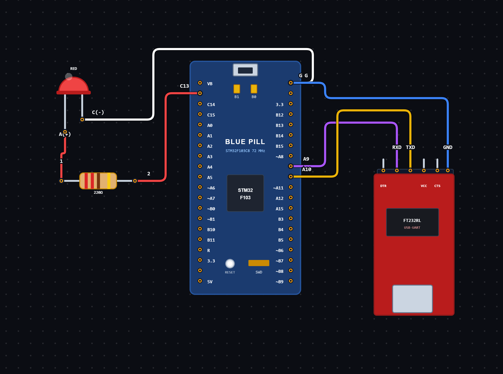

# EXPERIMENT DETAILS

**EXP:** CONTINUOUS ASSESSMENT 9

**DATE:** 01/10/2026

**NAME OF EXP:** LED Control using UART Commands with STM32

**HARDWARE SETUP / PLATFORM:** STM32 Microcontroller + STM32CubeIDE / HAL Library

---

## TASK 9B : LED Control using UART Communication

### 1. Circuit Diagram

The experiment demonstrates controlling an LED using commands received through UART serial communication.

- **Microcontroller:** STM32
- **Communication Peripheral:** USART1
- **Input Device:** Serial Terminal
- **Output Device:** On-board LED
- **Output GPIO Pin:** PC13
- **Communication Mode:** UART Transmit and Receive
- **Baud Rate:** 115200
- **Word Length:** 8 Bits
- **Stop Bits:** 1
- **Parity:** None
- **Hardware Flow Control:** Disabled
- **Programming Environment:** STM32CubeIDE

**Circuit Diagram:**

### 2. Core Logic / Pseudocode / Code Base

**Working Principle:**

The experiment uses UART communication to control the on-board LED connected to PC13 of the STM32 microcontroller.

The STM32 continuously receives characters through USART1 using the `HAL_UART_Receive()` function. The received characters are stored in a buffer until a carriage return (`\r`) or newline (`\n`) character is detected.

Once a complete command is received, the program compares the command with predefined strings using the `strcmp()` function.

Based on the received command, the LED performs the corresponding operation.

**Operating Conditions:**

| UART Command | LED Behaviour |
| ----------------------------------- | -------------------------------- |
| `LED ON` | Turns ON the LED |
| `LED OFF` | Turns OFF the LED |
| `LED TOGGLE` | Changes the current LED state |

The LED is controlled using active-LOW logic:
- `GPIO_PIN_RESET` turns the LED ON.
- `GPIO_PIN_SET` turns the LED OFF.

**Pseudocode:**

1. Initialize the HAL library using `HAL_Init()`.
2. Configure the system clock using `SystemClock_Config()`.
3. Initialize GPIO and USART1 peripherals.
4. Create a character buffer to store incoming commands.
5. Enter an infinite loop.
6. Receive one character through USART1 using `HAL_UART_Receive()`.
7. Check whether the received character is a carriage return or newline.
8. If a command-ending character is received:
   - Add the null character `\0` to terminate the string.
   - Compare the received command using `strcmp()`.
9. If the command is `LED ON`:
   - Set PC13 to RESET to turn ON the LED.
10. If the command is `LED OFF`:
    - Set PC13 to SET to turn OFF the LED.
11. If the command is `LED TOGGLE`:
    - Change the LED state using `HAL_GPIO_TogglePin()`.
12. If the received character is not a command-ending character:
    - Store it in the buffer.
    - Increment the buffer index.
13. Repeat continuously.

**Code Base:**

The program is written in Embedded C using the STM32 HAL library.

- `main.h` provides the required STM32 definitions and HAL declarations.
- `string.h` provides string-handling functions such as `strcmp()`.
- `UART_HandleTypeDef huart1` defines the UART handle for USART1.
- `HAL_Init()` initializes the HAL library and system tick.
- `SystemClock_Config()` configures the system clock.
- `MX_GPIO_Init()` initializes the GPIO peripherals.
- `MX_USART1_UART_Init()` configures USART1 for serial communication.
- `HAL_UART_Receive()` receives one character at a time through USART1.
- `HAL_GPIO_WritePin()` controls the LED connected to PC13.
- `HAL_GPIO_TogglePin()` toggles the LED state.
- `buffer[20]` stores the incoming command characters.
- `rx` stores the currently received character.
- `index` keeps track of the position at which the next character is stored.
- `strcmp()` compares the received command with the predefined command strings.
- A carriage return or newline character indicates the end of a command.

### 3. Inference

The experiment demonstrates UART-based LED control using the STM32 microcontroller.

Commands are sent through a serial terminal and received by the STM32 using USART1. Based on the received command, the on-board LED can be turned ON, turned OFF or toggled.

The experiment provides an understanding of UART data reception, string handling, command-based control, GPIO operations and interfacing serial communication with an output device using Embedded C programming.